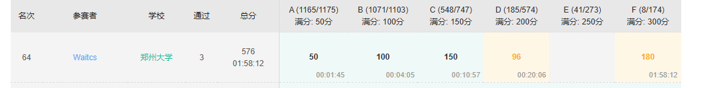

https://ac.nowcoder.com/acm/contest/143406#question


## D

只要固定了$a_1=x,其余均可以推导出来$

第一箱 \(a_1=x\) 表示所有箱子。把 \(s_i\) 的定义固定下来，约束就清楚了。

设：

\[ s_1=0,\qquad s_{i+1}=b_i-s_i \]

由 \(a_{i+1}=b_i-a_i\)，得到：

\[ a_i= \begin{cases} x+s_i,&i\text{ 为奇数}\\ s_i-x,&i\text{ 为偶数} \end{cases} \]

**每箱至少一个球，所以奇数位置限制下界，偶数位置限制上界：**

- 奇数位置：\(x+s_i\ge1\)，即 \(x\ge1-s_i\)。
- 偶数位置：\(s_i-x\ge1\)，即 \(x\le s_i-1\)。

因此你说的取最大、最小是对的：

\[ L=\max_{i\text{ 为奇数}}(1-s_i),\qquad R=\min_{i\text{ 为偶数}}(s_i-1) \]

其中 \(s_1=0\)，已经包含 \(x\ge1\)。若 \(L>R\)，就无解。

接下来，要让最大的箱子尽可能小。记：

\[ O=\max_{i\text{ 为奇数}}s_i,\qquad E=\max_{i\text{ 为偶数}}s_i \]

那么： [牛客周赛 Round 170.md](牛客周赛 Round 170.md) 

\[ \boxed{f(x)=\max(x+O,\ E-x)},\qquad L\le x\le R \]

因为奇数位置的最大值是 \(x+O\)，偶数位置的最大值是 \(E-x\)。

**一个随 \(x\) 增大而增大，另一个随 \(x\) 增大而减小，所以尽量让两者相等：**

\[ x+O=E-x \quad\Longrightarrow\quad x=\frac{E-O}{2} \]

取这个位置附近的整数，再限制在 \([L,R]\) 中即可。

例如第一组：

```
b：3 8 9
s：0 3 5 4
a：x，3-x，5+x，4-x
```

正整数约束得到 \(1\le x\le2\)。

而 \(O=5,E=4\)，交点是 \(-0.5\)，在可行区间左边，因此取 \(x=1\)：

\[ a=[1,2,6,3],\qquad \text{答案}=6. \]

你目前已经推到了可行区间；再把目标写成 **两个一次函数的最大值**，就能直接求最优，不需要枚举所有箱子方案。

## F · qc的树：把路径翻转转化为边收益

2026-11-16 复盘。原实现用户反馈 180/300；经 AI 辅助整理树形 DP，尚未收到修改后在线 AC 的反馈。[题目](https://ac.nowcoder.com/acm/contest/143406/F)

### 为什么只看边界

翻转路径上所有点的 0/1 颜色，最大化异色边数：路径内部的边两端同时翻转，异同关系不变；路径外的边不变；只有恰好一端在路径上的边改变。

对一条边定义 w：原本同色取 +1，原本异色取 -1。这是只翻转一端时异色边数的变化。

固定根，single[u] 表示必须包含 u、从 u 向下的一条翻转路径在 u 子树内部的最大收益，不计父边。这个值允许为负数。

先只翻转 u，子边总收益为 base = Σ w(u,v)。若接入孩子 v，连接边两端都翻转，应撤销原先的 w(u,v)，再加上孩子单链收益。因此延伸的额外收益是：

$$
gain(v)=single[v]-w(u,v).
$$

将所有孩子的 gain 与“不延伸”的 0 比较，取最大的两个非负收益 first、second：

$$
single[u]=base+first.
$$

以 u 为最高点的完整路径，向下最多接两个孩子，并且父亲不在路径中，故候选总收益为：

$$
base+first+second+w(u,parent[u]).
$$

根节点没有父边，最后一项取 0。所有节点候选取最大值 add，答案为原异色边总数 + add。以下实现按允许不操作处理，add 初始为 0；如果题目要求必须翻转非空路径，则必须将 add 初始化为负无穷，不能直接保留不操作收益。

### 核心代码

```cpp
void dfs(int u, int parent) {
    cnt[u] = 0;
    int base = 0, first = 0, second = 0;
    for (int v : edge[u]) {
        if (v == parent) continue;
        dfs(v, u);
        cnt[u] += cnt[v] + (a[u] != a[v]);
        int w = (a[u] == a[v] ? 1 : -1);
        base += w;
        int gain = single[v] - w;
        if (gain > first) {
            second = first;
            first = gain;
        } else if (gain > second) {
            second = gain;
        }
    }
    single[u] = base + first;
    int parentGain = parent == -1 ? 0 : (a[u] == a[parent] ? 1 : -1);
    add = max(add, base + first + second + parentGain);
}
// add = 0; dfs(1, -1); cout << cnt[1] + add;
```

时间 O(n)，数组空间 O(n)。长链上的递归深度可能达到 n，可用父节点数组和遍历序列逆序实现相同转移。

### 原代码为什么会多算

不能根据“孩子子树是否全部异色”过滤孩子，也不能直接假设两条异色子边一定能被路径保留。必须计算接入每个孩子的实际 gain。

```text
6
0 1 0 0 0 0
1 2
2 3
1 4
2 5
1 6
```

原代码实际输出 5，枚举所有路径最优为 4；只翻转 1 就能得到 4。节点 2 的两个孩子 3、5 都与它异色，向下路径最多保留其中一条连接边，所以 single[2] = -1，不能因为子树已全异色而提前返回默认值 0。

去掉提前返回仍不足以修复：筛掉孩子后，后续公式依然无条件减免两条异色边的损失。重写后还要确保 dfs2 内部递归调用 dfs2，不能混用旧 dfs。

复做重点：先算“只选择当前点”的收益，再计算“多接一个孩子”带来的变化。状态边界明确后，单链取一个最大增量，整条路径取两个最大增量。

## E · 合法区间计数：从一个人无法到达补给站入手

2026-11-16，AI 辅助推导。[题目](https://ac.nowcoder.com/acm/contest/143406/E)

### 反向考虑不合法条件

第 i 个人导致区间 [l,r] 不合法，当且仅当左右两个站都走不到：

$$
i-l+1>a_i,\qquad r-i+1>a_i.
$$

因为位置和距离都是整数，可改写为：

$$
\boxed{l\le i-a_i,\qquad r\ge i+a_i.}
$$

所以第 i 个人从右端点达到 R_i = i+a_i 时开始施加限制：合法区间必须满足 l > L_i = i-a_i。a_i ≥ 1 保证满足这两个不等式时 i 确实处在区间内。

### 枚举右端点，合并所有限制

固定右端点 r，所有满足 i+a_i ≤ r 的人都已经激活。定义：

$$
bad(r)=\max\left(0,\max_{i+a_i\le r}(i-a_i)\right).
$$

合法左端点恰好是 bad(r)+1 到 r，共 r-bad(r) 个。于是答案为 Σ(r-bad(r))。

每个人的限制一旦激活，此后一直有效，bad 只会增加。用数组 event[R_i] 记录在 R_i 激活的最大 L_i，顺序扫描时维护前缀最大值即可。R_i > n 的人不可能导致任何区间不合法，可以忽略；L_i ≤ 0 的限制也不会排除合法左端点。

```cpp
void solve() {
    int n;
    cin >> n;
    vector<int> event(n + 1, 0);
    for (int i = 1; i <= n; ++i) {
        long long a;
        cin >> a;
        if (i + a <= n) {
            int r = int(i + a);
            event[r] = max(event[r], int(i - a));
        }
    }
    long long ans = 0;
    int bad = 0;
    for (int r = 1; r <= n; ++r) {
        bad = max(bad, event[r]);
        ans += r - bad;
    }
    cout << ans << '\n';
}
```

时间 O(n)，空间 O(n)。答案可能达到 n(n+1)/2，使用 long long。

### 样例逐步计算

a = [2,1,3,1,2]。第 2 个人在 r = 3 时激活，要求 l > 1；第 4 个人在 r = 5 时激活，要求 l > 3。

| r | bad | 合法左端点 | 数量 |
| --- | --- | --- | --- |
| 1 | 0 | 1 | 1 |
| 2 | 0 | 1..2 | 2 |
| 3 | 1 | 2..3 | 2 |
| 4 | 1 | 2..4 | 3 |
| 5 | 3 | 4..5 | 2 |

合计 10。另一个样例 [3,3,3] 没有任何人激活限制，答案为 1+2+3=6。

本次将该 O(n) 计数法与直接枚举区间、逐人检查的暴力比较：n = 1..7、每个 a_i = 1..4，共 21844 组全部一致。这是本地验证，不代表在线提交 AC。

知识点：把“每个人至少能到一个站”的或条件，取反为“两边都到不了”的且条件；再把二维端点约束转成右端点激活事件与左端点下界。

### 固定左端点：右端点最大合法位置取所有上界的最小值

自己的理解：左边界滑动，维护右边界的临界位置；右端点必须满足所有人的要求，因此最大合法右端点等于所有已生效上界的最小值。

仍从不合法条件出发：l ≤ i-a_i 且 r ≥ i+a_i。当 l ≤ i-a_i 时，第 i 个人走不到左站，必须保证他能到右站，因此：

$$
r<i+a_i\quad\Longleftrightarrow\quad r\le i+a_i-1.
$$

例如同时有 r ≤ 8、r ≤ 5、r ≤ 7，最终必须 r ≤ 5。固定左端点 l 后，令最大合法右端点为 R，则合法右端点为 l..R，数量为 R-l+1。

### 为什么左端点从右往左扫描

l 向左移动，左站 l-1 也向左移动。对某个人而言，一旦走不到左站，之后左站只会更远，他对右端点的限制会一直有效。因此倒序扫描时限制只增加、不撤销，用一个最小值即可维护。

例如第 3 个人只能走 1 步：l=3 时左站在 2，能到；l=2 时左站在 1，不能到，从此必须 r ≤ 3；l=1 时这个限制依旧有效。如果正序扫描，就需要在 l=3 时撤销此限制，单靠 min 无法恢复之前更大的上界。

### 排序题解与指针的含义

每个人存成一对 (L_i,R_i)=(i-a_i,i+a_i)。按 L_i 从大到小排序，同时让 l 从 n 递减到 1：

- 所有 L_i ≥ l 的限制都生效，指针 j 将它们依次加入。
- mn 维护所有生效限制的最小 R_i，因此右端点必须 r < mn。
- 当前最大合法右端点为 min(n,mn-1)，当前贡献为 min(n,mn-1)-l+1。
- 指针只前进，每个人处理一次；排序占 O(n log n)，扫描 O(n)。

下面使用明确的 pair 成员和 long long，避免依赖题解模板中的类型别名或宏；只存 n 个事件，不额外放一个默认元素。

```cpp
void solve() {
    int n;
    cin >> n;
    vector<pair<long long, long long>> events;
    events.reserve(n);
    for (int i = 1; i <= n; ++i) {
        long long a;
        cin >> a;
        events.emplace_back(i - a, i + a);
    }
    sort(events.rbegin(), events.rend());

    long long ans = 0;
    long long mn = n + 1LL; // 初始没有额外限制，r 最多为 n
    int j = 0;
    for (int l = n; l >= 1; --l) {
        while (j < n && events[j].first >= l) {
            mn = min(mn, events[j].second);
            ++j;
        }
        ans += max(0LL, min((long long)n, mn - 1) - l + 1);
    }
    cout << ans << '\n';
}
```

也可以用长度 n+1 的数组，在 L_i 处记录新出现的上界 R_i-1（仅处理 L_i ≥ 1），倒序维护后缀最小值，省去排序，得到 O(n) 做法。

两种方向对照：固定右端点并递增，维护左端点下界的最大值；固定左端点并递减，维护右端点上界的最小值。核心都是选取一个让限制只增加的扫描方向。
