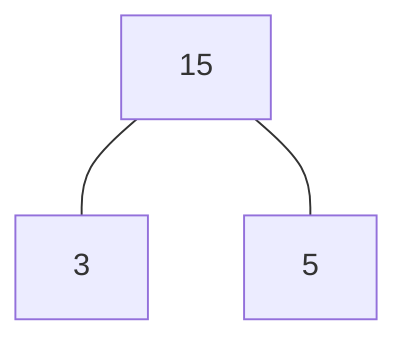
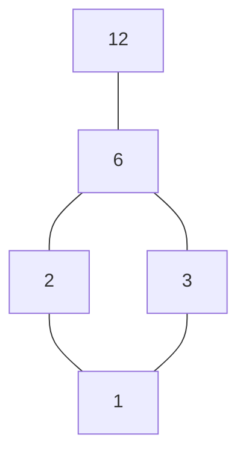
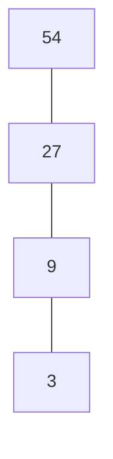

# 离散数学

> 按教材目录编排。★ 标出目录照片中有明显勾画的小节。

[TOC]

## 课件与页码索引

页码均为上传 PDF 从第 1 页开始计数的物理页码，包含封面。三份课件分别从第 1 页重新编号，本次核对到的页脚页码与物理页码一致。章节编号沿用原笔记；课件编排不同时，在小节下单独说明。

| 课件简称 | 上传课件 | 总页数 |
| --- | --- | --- |
| 《命题逻辑》 | [离散数学-2025_1（命题逻辑).pdf](https://chatgpt.com/library?file_id=libfile_3f335383ff3081918d9761a01a912e2e&account_id=personal) | 139 |
| 《谓词逻辑》 | [离散数学-2025_2（谓词逻辑）.pdf](https://chatgpt.com/library?file_id=libfile_ad8a51886c948191897f19496ae2ac47&account_id=personal) | 41 |
| 《集合论+》 | [离散数学-2025_3（集合论+）.pdf](https://chatgpt.com/library?file_id=libfile_729ff25073ac8191ab433b42615ee99c&account_id=personal) | 113 |

各小节开头标注对应页码。作业例题与反例是基于相关知识点整理的补充，不表示它们均为课件原题。课件未覆盖的原笔记内容标注为补充。

| 笔记小节 | 知识点 | 课件 | PDF 页码 |
| --- | --- | --- | --- |
| 1-1 | 命题及其表示法 | 《命题逻辑》 | 34–38 |
| 1-2 | 联结词 | 《命题逻辑》 | 39–50 |
| 1-3 | 命题公式与翻译 | 《命题逻辑》 | 52–58 |
| 1-4 | 真值表与等价公式 | 《命题逻辑》 | 59–74 |
| 1-5 | 重言式与蕴含式 | 《命题逻辑》 | 63–64、75–81 |
| 1-6 | 其他联结词 | 《命题逻辑》 | 82–91 |
| 1-7 | 对偶与范式 | 《命题逻辑》 | 92–110 |
| 1-8 | 推理理论 | 《命题逻辑》 | 111–118 |
| 1-9 | 应用 | 《命题逻辑》 | 119–139 |
| 2-1 | 谓词的概念与表示 | 《谓词逻辑》 | 3–5 |
| 2-2 | 命题函数与量词 | 《谓词逻辑》 | 6–10、28–30 |
| 2-3 | 谓词公式与翻译 | 《谓词逻辑》 | 11–14 |
| 2-4 | 变元的约束 | 《谓词逻辑》 | 15–18 |
| 2-5 | 谓词演算的等价式与蕴含式 | 《谓词逻辑》 | 19–30 |
| 2-6 | 前束范式 | 《谓词逻辑》 | 31–32 |
| 2-7 | 谓词演算的推理理论 | 《谓词逻辑》 | 33–41 |
| 3-1 | 集合的概念和表示法 | 《集合论+》 | 3–9 |
| 3-2 | 集合的运算 | 《集合论+》 | 10–24 |
| 3-3 | 包含排斥原理 | 未覆盖 | — |
| 3-4 | 序偶与笛卡尔积 | 《集合论+》 | 25–32 |
| 3-5 | 关系及其表示 | 《集合论+》 | 33–39 |
| 3-6 | 关系的性质 | 《集合论+》 | 40–44 |
| 3-7 | 复合关系和逆关系 | 《集合论+》 | 45–54 |
| 3-8 | 关系的闭包运算 | 《集合论+》 | 55–62 |
| 3-9 | 集合的划分和覆盖 | 《集合论+》 | 63 |
| 3-10 | 等价关系与等价类 | 《集合论+》 | 64–69 |
| 3-11 | 相容关系 | 《集合论+》 | 70–72 |
| 3-12 | 序关系 | 《集合论+》 | 73–82 |
| 4-1 | 函数的概念 | 《集合论+》 | 83–88 |
| 4-2 | 逆函数和复合函数 | 《集合论+》 | 89–92 |
| 4-3 | 特征函数与模糊子集 | 未覆盖 | — |
| 4-4 | 基数的概念 | 《集合论+》 | 93–95 |
| 4-5 | 可数集与不可数集 | 《集合论+》 | 96–101 |
| 4-6 | 基数的比较 | 《集合论+》 | 102–103 |

关系运算的综合练习另见《集合论+》第 104–112 页。第 5–9 章未提供对应课件，因此暂不标注课件页码。

## 第一篇 数理逻辑

### 第一章 命题逻辑

#### 1-1 命题及其表示法

> 课件《命题逻辑》第 34–38 页。

用 $p,q,r$ 表示具有确定真值的陈述，再用联结词组成复合命题。

- “$2+3=5$”是真命题。
- “$2+3=6$”是假命题，但它仍然是命题。
- “你会做这道题吗？”是问句，不是命题。
- “$x>0$”在没有给定 $x$ 的情况下，不能直接确定真假。

**注意：命题不要求为真，也不要求我们已经知道它的真假。**

##### 命题、真值与原子命题

> 对应《命题逻辑》第 34–38 页。

命题是具有确定真值的陈述句。不能再分解为更简单命题的称为原子命题，由联结词连接起来的称为复合命题。命题变元表示任意命题，真值指派给它指定真或假。

#### 1-2 联结词

> 课件《命题逻辑》第 39–50 页。

$\neg$ 表示否定，$\land$ 要求两者都真，$\lor$ 要求至少一个真，$\to$ 只在前真后假时为假，$\leftrightarrow$ 要求两边真值相同。

$A\to B$ 只在“$A$ 真、$B$ 假”时为假，等价于 $\neg A\lor B$。

“如果一个数是 $4$ 的倍数，那么它是偶数”：只有找到一个“是 $4$ 的倍数，却不是偶数”的数，才能推翻它。不是 $4$ 的倍数的数，不构成反例。

这正是后面“所有学生……”通常使用蕴含的原因：我们只对学生提出要求，不对其他对象提出要求。

##### 五个联结词的真值表

> 对应《命题逻辑》第 41–50 页。

| $p$ | $q$ | $\neg p$ | $p\land q$ | $p\lor q$ | $p\to q$ | $p\leftrightarrow q$ |
| --- | --- | --- | --- | --- | --- | --- |
| 1 | 1 | 0 | 1 | 1 | 1 | 1 |
| 1 | 0 | 0 | 0 | 1 | 0 | 0 |
| 0 | 1 | 1 | 0 | 1 | 1 | 0 |
| 0 | 0 | 1 | 0 | 0 | 1 | 1 |

默认优先级按 $\neg,\land,\lor,\to,\leftrightarrow$ 从高到低理解，存在歧义就加括号。「只要 $p$ 就 $q$」是 $p\to q$，「只有 $p$ 才 $q$」是 $q\to p$。

#### 1-3 命题公式与翻译

> 课件《命题逻辑》第 52–58 页。

用括号明确作用范围。“如果 $p$ 就 $q$”写成 $p\to q$。“只有 $p$ 才 $q$”写成 $q\to p$，例如“只有刷卡才能进入”禁止进入却没刷卡。

#### 1-4 真值表与等价公式 ★

> 课件《命题逻辑》第 59–74 页。 真值表与公式分类见第 59–64 页，等价公式见第 65–74 页，课件将后者列在 1-5 节。

$n$ 个变元有 $2^n$ 种赋值。若两式每行真值都相同，则 $A\equiv B$。常用等值式有 $p\to q\equiv\neg p\lor q\equiv\neg q\to\neg p$。

##### 常用等价变形

> 对应《命题逻辑》第 65–74 页，公式表见第 67 页。

$$
\begin{aligned}
\neg(p\land q)&\equiv\neg p\lor\neg q,\\
\neg(p\lor q)&\equiv\neg p\land\neg q,\\
p\to q&\equiv\neg p\lor q\equiv\neg q\to\neg p,\\
p\leftrightarrow q&\equiv(p\to q)\land(q\to p),\\
p\land(p\lor q)&\equiv p,\\
p\lor(p\land q)&\equiv p.
\end{aligned}
$$

等价代换可以在公式的局部使用。证明等价时，每一步都要保留相同真值。

#### 1-5 重言式与蕴含式 ★

> 课件《命题逻辑》第 63–64、75–81 页。 重言式分类见第 63–64 页，蕴含式见第 75–81 页。

全真是重言式，全假是矛盾式，至少有一行为真叫可满足。$A\models B$ 当且仅当 $A\to B$ 恒真。

##### 条件、蕴含和逆否

> 对应《命题逻辑》第 74–79 页。

$p\to q$ 是一个命题公式，某次赋值下可以为假；$P\models Q$ 要求所有赋值都满足 $P\to Q$。

原式 $p\to q$ 的逆命题是 $q\to p$，否命题是 $\neg p\to\neg q$，逆否命题是 $\neg q\to\neg p$。原式与逆否式等价，但通常不与逆命题等价。

#### 1-6 其他联结词

> 课件《命题逻辑》第 82–91 页。

异或要求恰有一个真。与非为 $\neg(p\land q)$，或非为 $\neg(p\lor q)$。对 $p$ 自身做与非就得到 $\neg p$。

##### 其他联结词与完备性

> 对应《命题逻辑》第 83–91 页。

- 异或 $p\oplus q\equiv(p\land\neg q)\lor(\neg p\land q)$。
- 条件否定 $\neg(p\to q)\equiv p\land\neg q$，见第 85 页。
- 与非 $p\uparrow q\equiv\neg(p\land q)$。
- 或非 $p\downarrow q\equiv\neg(p\lor q)$。

若一组联结词能表示所有真值函数，称为完备联结词组。$\{\neg,\land\}$、$\{\neg,\lor\}$、$\{\uparrow\}$、$\{\downarrow\}$ 均完备。$\{\land,\lor\}$ 不完备，因为不能表示否定。第 91 页的列表存在误列，按上述结论记忆。$\{\neg,\land,\lor\}$ 完备，但删去其中的 $\land$ 或 $\lor$ 后仍完备，所以它不是最小完备组。

#### 1-7 对偶与范式 ★

> 课件《命题逻辑》第 92–110 页。

对偶同时交换 $\land,\lor$ 和 $0,1$。主析取范式取真行的极小项相或，主合取范式取假行的极大项相与，每项都包含所有变元。赋值 $(1,0)$ 对应极小项 $p\land\neg q$ 和极大项 $\neg p\lor q$。

##### 范式的构造步骤

> 对偶见《命题逻辑》第 92–95 页，普通范式见第 96–100 页，主范式见第 101–110 页。

| 类型 | 结构 | 真值表的选行方法 |
| --- | --- | --- |
| 析取范式 DNF | 若干合取项取析取 | 每项不必出现所有变元 |
| 合取范式 CNF | 若干析取项取合取 | 每项不必出现所有变元 |
| 主析取范式 | 各极小项取析取 | 取结果为 1 的行 |
| 主合取范式 | 各极大项取合取 | 取结果为 0 的行 |

主范式中每项必须包含全部变元，且每个恰好出现一次。

- 极小项要在指定行取 1。变量取 1 时写原变量，取 0 时写否定。
- 极大项要在指定行取 0。变量取 0 时写原变量，取 1 时写否定。

例如赋值 $(p,q)=(1,0)$ 对应极小项 $p\land\neg q$，极大项 $\neg p\lor q$。取对偶前，先把 $\to,\leftrightarrow$ 改写成 $\neg,\land,\lor$，再交换 $\land,\lor$ 与常量 $0,1$。

#### 1-8 推理理论

> 课件《命题逻辑》第 111–118 页。

前提的合取蕴含结论必须恒真。由 $p,p\to q$ 得 $q$，由 $\neg q,p\to q$ 得 $\neg p$。从 $q,p\to q$ 推出 $p$ 会失败，取 $p=0,q=1$ 即可验证。

##### 证明充要条件

$P\iff Q$ 需要证明两个方向：

1. 假设 $P$ 成立，推出 $Q$（证明 $Q$ 是 $P$ 的必要条件，简称必要性）。
2. 假设 $Q$ 成立，推出 $P$（证明 $Q$ 是 $P$ 的充分条件，简称充分性）。

只证明一个方向不够。

##### 作业证明的书写方法

> 对应《命题逻辑》第 111–118 页，规则见第 113 页，反证法见第 115 页，CP 规则见第 116 页。

每一步写「得到的公式、依据的前提或步骤、使用的规则」。P 规则引入前提，T 规则用等价式或有效推理继续推导。

常用规则包括 $p,p\to q\vdash q$，$\neg q,p\to q\vdash\neg p$，$p\lor q,\neg p\vdash q$。证明结论 $p\to q$ 时，可暂加 $p$ 为前提推出 $q$；反证法则加上结论的否定并推出矛盾。

#### 1-9 应用

> 课件《命题逻辑》第 119–139 页。

把约束写成公式，再求同时满足的赋值。例如“两台机器恰开一台，且开 $p$ 必须开 $q$”对应 $(p\oplus q)\land(p\to q)$，解为 $p=0,q=1$。

### 第二章 谓词逻辑

#### 2-1 谓词的概念与表示

> 课件《谓词逻辑》第 3–5 页。

先约定讨论范围是整数，定义：

| 写法 | 含义 | 代入例子 |
| --- | --- | --- |
| $P(x)$ | $x>0$ | $P(3)$ 真，$P(-2)$ 假 |
| $E(x)$ | $x$ 是偶数 | $E(4)$ 真，$E(3)$ 假 |
| $R(x,y)$ | $x>y$ | $R(5,2)$ 真，$R(2,5)$ 假 |

一个参数描述性质，两个或更多参数可以描述关系。可以把它类比为一个返回真假值、带有参数的判断条件。

#### 2-2 命题函数与量词 ★

> 课件《谓词逻辑》第 6–10、28–30 页。 量词顺序在课件 2-5 节第 28–30 页。

命题函数的真值随参数变化。$\forall x$ 要求任意对象成立，$\exists x$ 要求至少有一个见证。

**论域就是变量可以取值的范围。写公式前先看题目规定了什么范围。**

例如同一个公式：

$$
\exists x\,(x<0)
$$

- 论域是整数时，为真，因为可以取 $x=-1$。
- 论域是自然数时，为假，因为自然数中没有负数。

因此，不能脱离论域直接判断公式真假。以下例子默认论域非空；实际作业以题目约定为准。

在有限论域中，可以用程序里的遍历来理解量词：$\forall$ 是检查所有对象，找到一个反例就失败；$\exists$ 是寻找一个满足条件的对象，找到一个就成功。无限论域则不能真的靠枚举检查完。

论域：整数，$R(x,y)$ 表示 $y>x$。

##### 先任意，再存在

$$
\forall x\,\exists y\,R(x,y)
$$

“对每个整数 $x$，都能找到一个比它大的整数 $y$。”为真，可以取 $y=x+1$。

**这里的 $y$ 可以随着 $x$ 改变。**

##### 先存在，再任意

$$
\exists y\,\forall x\,R(x,y)
$$

“存在一个固定整数 $y$，比所有整数 $x$ 都大。”为假：无论选哪个 $y$，取 $x=y+1$ 就能推翻它。

**这里必须先确定同一个 $y$，再让它应对所有 $x$，不能临时更换。**

类比算法：“每个测试用例都能找到一种方案”和“存在同一种方案能解决所有测试用例”，不是同一个要求。

#### 2-3 谓词公式与翻译

> 课件《谓词逻辑》第 11–14 页。

##### 原子公式与复合公式

最简单的谓词公式是**原子公式**，例如 $P(x)$、$R(x,y)$。

把公式用逻辑联结词连接，或者加上量词，可以得到更复杂的公式：

$$
P(x)\land E(x)
$$

表示“$x$ 是正数，并且 $x$ 是偶数”。

$$
\exists x\,(P(x)\land E(x))
$$

表示“存在一个正偶数”。

**谓词公式不一定为真，也不一定有量词；关键是它是否按照语法规则组成。**

例如 $P(x)\land E(x)$ 是公式，单独的 $x+1$ 只是表示一个对象的表达式，不是公式；单独写 $\forall x$ 也没有构成完整公式。

##### 中文翻译例题

###### 例 1：所有学生都交了作业

论域：所有人。定义 $S(x)$ 表示“$x$ 是学生”，$H(x)$ 表示“$x$ 交了作业”。

$$
\forall x\,(S(x)\to H(x))
$$

读成：“对每个人，如果他是学生，那么他交了作业。”

不能写成 $\forall x\,(S(x)\land H(x))$，那会要求**所有人都是学生，而且所有人都交了作业**。

如果题目直接把论域限定为“所有学生”，就可以简写成 $\forall x\,H(x)$。

###### 例 2：有学生交了作业

沿用“所有人”的论域：

$$
\exists x\,(S(x)\land H(x))
$$

要找到的同一个人，必须同时满足“是学生”和“交了作业”。

不要写成 $\exists x\,(S(x)\to H(x))$：只要找到一个不是学生的人，括号里的蕴含就成立，却没有说明任何学生交了作业。

###### 例 3：没有学生交作业

$$
\neg\exists x\,(S(x)\land H(x))
$$

也可以写成：

$$
\forall x\,(S(x)\to\neg H(x))
$$

**不是“所有学生都交了”的否定！** “并非所有学生都交了”只表示至少有一个学生没交，不代表所有学生都没交。

###### 例 4：存在一个正偶数

论域：整数，$P(x)$ 表示“正数”，$E(x)$ 表示“偶数”。

$$
\exists x\,(P(x)\land E(x))
$$

可以用 $x=2$ 作为满足条件的例子。这种用来证明“存在”的具体对象，叫作一个见证。

##### 做题检查顺序

1. **确定论域**：整数、所有人，还是某个班的学生？
2. **定义谓词**：每个字母表示什么？参数分别是谁？
3. **标出关键词**：“所有”“存在”“没有”“不是所有”“如果”。
4. **安排量词顺序**：后选的对象能不能依赖先给定的对象？
5. **写清括号和范围**：全称限定对象常用蕴含，存在指定对象常用合取；先理解含义，不机械套词。
6. **检查自由变量与反例**：有没有漏掉的量词？公式是否真的表达原句？

如果一个知识点完全不会，就先用自己的话说明一个例子，再做同类作业。不要只抄符号，也不必为了这一类题先补完所有未听的章节。

#### 2-4 变元的约束

> 课件《谓词逻辑》第 15–18 页。

改绑定变量名时，只改该量词约束的出现，并选用不会捕获原自由变量的新名字。

量词管辖的那一部分公式，叫作它的**作用域**。

$$
\forall x\,(P(x)\lor R(x,y))
$$

- 两处 $x$ 都受 $\forall x$ 约束，叫作 $x$ 的约束出现。
- $y$ 没有被量词约束，是自由变量。
- 即使写了量词，公式仍可能含有自由变量；这个公式的真假仍可能依赖 $y$ 的取值。

再看：

$$
(\forall x\,P(x))\land R(x,y)
$$

前半部分的 $x$ 受约束，后半部分的 $x$ 却是自由的，因为它在量词作用域之外。**判断自由还是约束，要看变量的每一次出现，不能只看字母相同。**

没有自由变量的公式叫作**闭公式**。在论域和符号含义确定后，闭公式具有确定真值；“闭公式”不等于“真公式”。

#### 2-5 谓词演算的等价式与蕴含式 ★

> 课件《谓词逻辑》第 19–30 页。

同类量词可以交换。全称对合取分配，存在对析取分配。$(\exists xP(x))\land(\exists xQ(x))$ 的两个见证可以不同。

最常用的两条规则：

$$
\neg\forall x\,P(x)\equiv\exists x\,\neg P(x)
$$

“不是每个人都会做”＝“存在一个人不会做”。

$$
\neg\exists x\,P(x)\equiv\forall x\,\neg P(x)
$$

“不存在会做的人”＝“每个人都不会做”。

否定往里推进时，**经过一个量词就交换一次 $\forall$ 与 $\exists$，最后否定里面的条件**。例如：

$$
\neg\forall x\,\exists y\,(y>x)
\equiv\exists x\,\forall y\,(y\le x)
$$

另外还会用到：

- $\neg(A\land B)\equiv\neg A\lor\neg B$。
- $\neg(A\lor B)\equiv\neg A\land\neg B$。
- $\neg(A\to B)\equiv A\land\neg B$，不是 $\neg A\to\neg B$。

所以“并非所有学生都交了作业”应写成：

$$
\exists x\,(S(x)\land\neg H(x))
$$

##### 量词分配与前移条件

> 量词分配见《谓词逻辑》第 23–26 页，作用域扩张收缩见第 27 页，量词顺序见第 28–30 页。

$$
\begin{aligned}
\forall x(P(x)\land Q(x))&\equiv(\forall xP(x))\land(\forall xQ(x)),\\
\exists x(P(x)\lor Q(x))&\equiv(\exists xP(x))\lor(\exists xQ(x)).
\end{aligned}
$$

全称对析取、存在对合取通常不能双向分配。$\exists x(P(x)\land Q(x))$ 需要同一个见证，$(\exists xP(x))\land(\exists xQ(x))$ 可以用不同见证。

若 $x$ 不在 $Q$ 中自由出现，在非空论域下有

$$
\begin{aligned}
(\forall xP(x))\to Q&\equiv\exists x(P(x)\to Q),\\
(\exists xP(x))\to Q&\equiv\forall x(P(x)\to Q).
\end{aligned}
$$

从蕴含前件移出或移入量词时，量词会翻转。移过后件时不翻转。先消去蕴含再操作，通常更容易检查。

#### 2-6 前束范式 ★

> 课件《谓词逻辑》第 31–32 页。

先消去蕴含，推入否定，重命名以免冲突，再前移量词。非空论域中，$\neg\forall x(P(x)\to\exists yR(x,y))\equiv\exists x\forall y(P(x)\land\neg R(x,y))$。前移 $\forall y$ 的依据是 $P(x)$ 中没有自由的 $y$。

##### 前束范式例题与改名

> 对应《谓词逻辑》第 31–32 页。下面先改名，再逐步前移量词。

$$
\begin{aligned}
(\forall xP(x))\to(\exists xQ(x))
&\equiv\neg\forall xP(x)\lor\exists yQ(y)\\
&\equiv(\exists x\neg P(x))\lor(\exists yQ(y))\\
&\equiv\exists x\exists y(\neg P(x)\lor Q(y)).
\end{aligned}
$$

不同作用域中的同名变量先分开改名，能避免变量捕获。第 31 页还利用存在量词对析取的分配，将本例进一步写成 $\exists x(\neg P(x)\lor Q(x))$，这一简化对本例成立。换成合取时，两个独立的存在量词通常不能合并为同一见证。

#### 2-7 谓词演算的推理理论

> 课件《谓词逻辑》第 33–41 页。

全称消去可代入任一合法对象，全称引入要求对象是任取的。存在引入给一个见证，存在消去用新名字暂指见证，结论须独立于临时名字。

##### 自测与答案

这些是理解检查，不是本周作业的替代品。

1. 论域为整数，$P(x)$ 表示“$x>0$”，$E(x)$ 表示“$x$ 是偶数”。写出“所有正整数都是偶数”，并判断真假。
2. 沿用上题，写出“并非所有正整数都是偶数”。
3. 论域为所有人，$S(x)$ 表示“学生”，$H(x)$ 表示“交了作业”。写出“存在一个没交作业的学生”。
4. 找出 $\forall x\,(P(x)\to R(x,y))$ 中的自由变量，判断它是否为闭公式。
5. 论域为整数，否定 $\exists y\,\forall x\,(x\le y)$，并用中文读出来。

参考答案：先独立尝试，再展开

1. $\forall x\,(P(x)\to E(x))$。为假，$x=1$ 是反例。
2. $\exists x\,(P(x)\land\neg E(x))$，即存在一个正整数不是偶数。
3. $\exists x\,(S(x)\land\neg H(x))$。
4. 自由变量是 $y$，不是闭公式；$x$ 的出现均受约束。
5. $\forall y\,\exists x\,(x>y)$，即“对任意一个整数 $y$，总能找到一个比它大的整数 $x$”。

##### 原笔记的复习方法

- 把作业题目先分成“中文符号化 / 判断真假 / 自由与约束变量 / 否定公式”等类型；暂时不认识的类型单独圈出，不硬套本笔记。
- 从原本的算法学习时间里划出一个短时段，例如 20 分钟，先理解一类、独立完成一道；不是额外给自己叠加一整套学习任务。
- 卡住时记录“我怎么定义论域和谓词、写到了哪一步、哪里不确定”，再针对这一步提问。
- 是否掌握，以合上例题后能不能自己翻译和解释为准，不以“看过答案”或“记下公式”为准。

##### 四条量词推理规则

> 对应《谓词逻辑》第 34–35 页，综合例题见第 36–41 页。

| 规则 | 用法 | 条件 |
| --- | --- | --- |
| US，全称指定 | $\forall xP(x)$ 得 $P(c)$ | 代入后不能使变量被意外约束 |
| ES，存在指定 | $\exists xP(x)$ 暂记见证满足 $P(c)$ | 使用新的名字，不假设它是任意对象 |
| UG，全称推广 | 任意对象 $c$ 满足 $P(c)$，推出 $\forall xP(x)$ | 不能依赖只针对 $c$ 的额外假设 |
| EG，存在推广 | 已有某对象满足 $P(c)$，推出 $\exists xP(x)$ | 明确给出了一个见证 |

两个存在前提分别提供的见证不能直接认作同一个。存在指定得到的临时名字不能无条件当作全称推广的任意对象。

## 第二篇 集合论

### 第三章 集合与关系

#### 3-1 集合的概念和表示法

> 课件《集合论+》第 3–9 页。

列举法写出元素，描述法给出元素的条件。两集合相等，当且仅当元素完全相同。

更新日期：2026-10-31。对应题目：求 $\{a,\{a\}\}$、$\{\varnothing,a,\{b\}\}$ 的幂集。

##### 元素与集合：先看最外层

集合中的元素也可以是集合。数元素时，把最外层花括号内逗号分隔的各项当作整体，不要把里面的集合拆开。

- $a$ 表示一个对象，$\{a\}$ 表示以 $a$ 为唯一元素的集合，不能把它们混为一谈。
- $\{a,\{a\}\}$ 有两个元素，分别是 $a$ 和 $\{a\}$。
- $\{\varnothing,a,\{b\}\}$ 有三个元素，分别是 $\varnothing$、$a$、$\{b\}$。
- 元素无序且不重复，例如 $\{a,b\}=\{b,a\}$，$\{a,a\}=\{a\}$。

本节例题按通常约定，把不同字母及题中列出的集合视为不同对象。

##### 属于与包含

| 写法 | 含义 | 判断方法 |
| --- | --- | --- |
| $x\in A$ | $x$ 是 $A$ 的元素 | 看 $x$ 是否作为一个整体列在 $A$ 中 |
| $B\subseteq A$ | $B$ 是 $A$ 的子集 | 看 $B$ 中每个元素是否都属于 $A$ |
| $B\subsetneq A$ | $B$ 是 $A$ 的真子集 | 先满足 $B\subseteq A$，再满足 $B\ne A$ |

例如 $A=\{a,\{a\}\}$ 时，下面四个判断都成立：

$$
a\in A,\qquad \{a\}\in A,\qquad \{a\}\subseteq A,\qquad \{\{a\}\}\subseteq A.
$$

其中 $\{a\}\in A$ 是因为 $\{a\}$ 本身是 $A$ 的一个元素；$\{a\}\subseteq A$ 是因为左侧集合的唯一元素 $a$ 属于 $A$。两句话成立的理由不同，不能互相代替。

##### 空集与含空集的集合

$$
\varnothing\ne\{\varnothing\},\qquad |\varnothing|=0,\qquad |\{\varnothing\}|=1.
$$

空集没有元素；$\{\varnothing\}$ 有一个元素，这个元素是空集。

对任意集合 $A$，都有 $\varnothing\subseteq A$，但不一定有 $\varnothing\in A$。

例如 $A=\{a\}$ 中没有空集这个元素；$A=\{\varnothing,a,\{b\}\}$ 中则有。

##### 幂集的定义与数量

集合 $A$ 的**所有子集组成的集合**称为 $A$ 的幂集，记为 $\mathcal P(A)$，也常记为 $P(A)$：

$$
\mathcal P(A)=\{B\mid B\subseteq A\}.
$$

因此：

$$
B\in\mathcal P(A)\iff B\subseteq A.
$$

若有限集合 $A$ 有 $n$ 个元素，则：

$$
|\mathcal P(A)|=2^n.
$$

理由：每个元素都有“选”和“不选”两种选择，$n$ 个元素共有 $2^n$ 种选择结果。

**列举方法：先列空集，再按选 1 个、2 个、……、全部元素的顺序列举。最后用 $2^n$ 检查数量。**

空集和原集合本身都是子集，不要漏掉。例如 $\mathcal P(\varnothing)=\{\varnothing\}$，并不是空集。

##### 本次例题

**例 1：$A=\{a,\{a\}\}$。**

把两个元素分别视为两个整体，得到 $2^2=4$ 个子集：

$$
\mathcal P(A)=\left\{\varnothing,\{a\},\{\{a\}\},\{a,\{a\}\}\right\}.
$$

$\{\{a\}\}$ 这一项表示只选中了原集合中的元素 $\{a\}$，因此还需要在外面加一层花括号。

**例 2：$A=\{\varnothing,a,\{b\}\}$。**

共 $2^3=8$ 个子集：

$$
\begin{aligned}
\mathcal P(A)=\big\{&\varnothing,\{\varnothing\},\{a\},\{\{b\}\},\\
&\{\varnothing,a\},\{\varnothing,\{b\}\},\{a,\{b\}\},\\
&\{\varnothing,a,\{b\}\}\big\}.
\end{aligned}
$$

这里 $\varnothing$ 表示一个元素也不选，$\{\varnothing\}$ 表示只选原集合中的空集元素。两种选择不同。

#### 3-2 集合的运算

> 课件《集合论+》第 10–24 页。

对称差 $A\triangle B=(A-B)\cup(B-A)$ 收集恰在一个集合中的元素。

##### 基本运算

设全集为 $U$，$A,B\subseteq U$。

| 运算 | 符号 | 元素条件 | 直观含义 |
| --- | --- | --- | --- |
| 并集 | $A\cup B$ | $x\in A$ 或 $x\in B$ | 两边合并、去重，“或”允许两者都成立 |
| 交集 | $A\cap B$ | $x\in A$ 且 $x\in B$ | 两边共有的元素 |
| 差集 | $A-B$ | $x\in A$ 且 $x\notin B$ | 从 $A$ 中删去属于 $B$ 的元素 |
| 补集 | $\overline A=U-A$ | $x\in U$ 且 $x\notin A$ | 全集中不属于 $A$ 的元素 |

例如 $A=\{1,2,3\}$、$B=\{2,3,4\}$，则：

$$
A\cup B=\{1,2,3,4\},\quad A\cap B=\{2,3\},\quad A-B=\{1\}.
$$

差集一般不满足交换律：$A-B$ 与 $B-A$ 通常不同。补集必须明确全集。

##### 常用运算法则

以下集合均为同一全集 $U$ 的子集，补集均相对于 $U$。

###### 交换律与结合律

$$
A\cup B=B\cup A,\qquad A\cap B=B\cap A.
$$

$$
(A\cup B)\cup C=A\cup(B\cup C),\qquad
(A\cap B)\cap C=A\cap(B\cap C).
$$

###### 分配律

$$
A\cap(B\cup C)=(A\cap B)\cup(A\cap C).
$$

$$
A\cup(B\cap C)=(A\cup B)\cap(A\cup C).
$$

###### 德摩根律

$$
\overline{B\cup C}=\overline B\cap\overline C,\qquad
\overline{B\cap C}=\overline B\cup\overline C.
$$

记忆：对整体取反时，内部各项取反，同时交换“并、交”。

###### 差集与包含关系

$$
A-B=A\cap\overline B.
$$

若 $C\subseteq A$，则：

$$
A\cap C=C,\qquad A\cup C=A.
$$

在已知一个集合包含于另一个集合的前提下，交集取较小的集合，并集取较大的集合。

##### 集合证明方法

###### 证明包含：$A\subseteq B$

任取 $x\in A$，根据条件推出 $x\in B$。因为 $x$ 是任意的，所以 $A\subseteq B$。

###### 证明相等：$A=B$

方法一：分别证明 $A\subseteq B$ 和 $B\subseteq A$。

方法二：任取 $x$，证明 $x\in A\iff x\in B$。每一步都必须是等价变换。

方法三：利用已知集合恒等式，把一边化成另一边。

##### 集合证明例题

###### 例一：集合等式成立的充要条件

证明：

$$
(A\cap B)\cup C=A\cap(B\cup C)\iff C\subseteq A.
$$

**必要性：** 假设等式成立，则：

$$
C\subseteq(A\cap B)\cup C=A\cap(B\cup C)\subseteq A.
$$

所以 $C\subseteq A$。直观理解：左边包含整个 $C$，右边全在 $A$ 中，因而整个 $C$ 必须在 $A$ 中。

**充分性：** 假设 $C\subseteq A$，则 $A\cap C=C$。由分配律：

$$
A\cap(B\cup C)=(A\cap B)\cup(A\cap C)=(A\cap B)\cup C.
$$

两个方向均成立，原命题得证。

###### 例二：连续作差等于减去并集

证明：

$$
(A-B)-C=A-(B\cup C).
$$

任取 $x$，有：

$$
\begin{aligned}
x\in(A-B)-C
&\iff x\in A\text{ 且 }x\notin B\text{ 且 }x\notin C\\
&\iff x\in A\text{ 且 }x\notin(B\cup C)\\
&\iff x\in A-(B\cup C).
\end{aligned}
$$

故等式成立。含义：先删去属于 $B$ 的元素，再删去属于 $C$ 的元素，等于一次删去属于 $B\cup C$ 的元素。

#### 3-3 包含排斥原理

> 补充知识。上传课件未设置该节，未检索到包含排斥原理的专门讲解。

并集计数按奇数重交取正、偶数重交取负。例如 $1$ 到 $100$ 中能被 $2$ 或 $3$ 整除的数有 $50+33-16=67$ 个。

#### 3-4 序偶与笛卡尔积

> 课件《集合论+》第 25–32 页。

序偶（有序对）有两个位置。两个序偶相等，当且仅当第一分量分别相等、第二分量也分别相等。

$$
(a,b)=(c,d)iff a=cland b=d.
$$

笛卡尔积把两个集合中的元素按顺序配成所有可能的序偶。第一分量从左边集合取，第二分量从右边集合取。

$$
A\times B=\{(a,b)\mid a\in A,\ b\in B\}.
$$

可以想成双重循环。固定一个 $a$，遍历所有 $b$。对有限集，每个 $a$ 都有 $|B|$ 种配法，所以 $|A\times B|=|A||B|$。

- 若 $A=\{0,1\}$、$B=\{1,2\}$，则 $A\times B=\{(0,1),(0,2),(1,1),(1,2)\}$。
- 求 $A^2\times B$ 时，先求 $A^2=A\times A$，再把其中的每个序偶整体作为第一分量，例如 $((0,1),2)$。本例共有 $2^2\cdot2=8$ 个序偶。
- 若 $A=\{a,b\}$，求 $P(A)\times A$ 时，第一分量是从幂集取出的一个子集，第二分量是从原集合取出的一个元素。例如 $(\{a\},b)$ 中的花括号要保留。第一分量有 $4$ 种选择，第二分量有 $2$ 种选择。

#### 3-5 关系及其表示

> 课件《集合论+》第 33–39 页。

从 $X$ 到 $Y$ 的二元关系 $R$ 是 $X\times Y$ 的任意子集。笛卡尔积给出所有候选序偶，每一种选法得到一个关系。若 $X$、$Y$ 有限，从 $X$ 到 $Y$ 的所有关系组成幂集 $P(X\times Y)$，共有 $2^{|X||Y|}$ 个。

例如 $X=\{a,b,c\}$、$Y=\{1\}$ 时，候选序偶是 $(a,1)$、$(b,1)$、$(c,1)$。按选中序偶数分组，选 $0$、$1$、$2$、$3$ 个分别有 $1$、$3$、$3$、$1$ 种，共 $8$ 个关系。一个都不选得到空关系，全部选中得到 $X\times Y$。

**同一个关系的三种表示**

集合 $A$ 上的关系满足 $R\subseteq A\times A$，所以 $x$ 和 $y$ 都先从 $A$ 取，再按条件筛选。以选中的序偶 $(3,1)$ 为例：

| 表示方式 | 规则 | 序偶 $(3,1)$ 对应的写法 |
| --- | --- | --- |
| 序偶集合 | 列出所有满足条件的序偶 | 把 $(3,1)$ 写进 $R$ |
| 关系矩阵 | 行是第一分量，列是第二分量。属于关系填 1，否则填 0 | 标为 3 的行、标为 1 的列填 1 |
| 关系图 | 同一集合上的关系用有向图表示，每个序偶对应一条箭头 | 画 $3\to1$ |

画图时先画出集合中的全部顶点。若有 $(x,x)$，则画自环 $x\to x$，它对应矩阵对角线上的 1。若两个方向都属于关系，就画双向箭头。

**怎样判断关系能否写成两个集合的笛卡尔积？**

看筛出的第一分量和第二分量是否能任意配对。若题目把条件写成只限制 $x$ 的条件与只限制 $y$ 的条件的合取，就能分别筛出两个集合，再相乘。

例题第（1）问中，$A=\{0,1,2,3,4\}$，条件是 $0\le x\land y\le3$。符号 $\land$ 读作「并且」。

| 分量 | 从 $A$ 中筛选的条件 | 筛出的集合 |
| --- | --- | --- |
| 第一分量 $x$ | $x\ge0$ | $\{0,1,2,3,4\}$ |
| 第二分量 $y$ | $y\le3$ | $\{0,1,2,3\}$ |

$$
R=\{0,1,2,3,4\}\times\{0,1,2,3\}.
$$

因为两个条件可以分别判断，每个允许的 $x$ 都能配上每个允许的 $y$，共 $20$ 个序偶。关系矩阵每一行都是 $(1,1,1,1,0)$。关系图中，每个顶点都向 $0,1,2,3$ 发出箭头，顶点 $4$ 没有入边。

**条件同时涉及两个分量时，固定第一分量逐行筛选**

- 条件 $0\le x-y<3$ 等价于 $x-y\in\{0,1,2\}$（这里取整数）。固定 $x$ 后，把 $y=x,x-1,x-2$ 与 $A$ 取交集。比如 $x=0$ 时只配 $0$，$x=3$ 时可配 $1,2,3$。虽然 $0$ 可以作第一分量、$3$ 可以作第二分量，但 $(0,3)$ 不符合条件，因此整个关系不能写成两个集合的笛卡尔积。
- 条件「$x$ 与 $y$ 互质」用 $\gcd(x,y)=1$ 判断。在 $A=\{2,3,4,5,6\}$ 中，顶点 $6$ 只和 $5$ 互质。互质与顺序无关，所以有 $6\to5$ 就有 $5\to6$，矩阵对称。这里所有元素均大于 $1$，所以没有自环。

##### 前域、值域与关系计数

> 对应《集合论+》第 34–37 页。

$$
\begin{aligned}
\operatorname{dom}R&=\{x\mid\exists y\,(xRy)\},\\
\operatorname{ran}R&=\{y\mid\exists x\,(xRy)\},\\
\operatorname{FLD}R&=\operatorname{dom}R\cup\operatorname{ran}R.
\end{aligned}
$$

$R\subseteq A\times B$ 不要求每个 $a\in A$ 都出现，因此前域可能严格小于 $A$。若 $|A|=m,|B|=n$，则从 $A$ 到 $B$ 的关系共有 $2^{mn}$ 个，因为每个序偶都可独立选择是否加入。

#### 3-6 关系的性质

> 课件《集合论+》第 40–44 页。

自反是每点有自环，反自反是每点无自环。对称要求有去有回，反对称禁止不同点间的双向边。传递要求 $xRy\land yRz\Rightarrow xRz$。

##### 五种性质怎么判断

> 自反、反自反见《集合论+》第 40 页，对称、反对称、传递见第 41 页，矩阵和图的判断见第 44 页。

把 $(a,b)\in R$ 记作 $aRb$，也可以把它看作箭头 $a\to b$。下面的变量都取自关系所在的集合。

| 选项 | 性质 | 判断方法 |
| --- | --- | --- |
| A | 自反 | 每个 $a$ 都有 $aRa$。漏掉一个自环就失败。 |
| B | 反自反 | 每个 $a$ 都没有 $aRa$。出现一个自环就失败。 |
| C | 对称 | $aRb\Rightarrow bRa$。有一条边缺少反向边就失败。 |
| D | 反对称 | $aRb\land bRa\Rightarrow a=b$。不同元素间出现双向边就失败，自环允许存在。 |
| E | 传递 | $aRb\land bRc\Rightarrow aRc$。只检查能首尾相接的两条边，找到一条缺少直达边的两步路径就失败。 |

自环只出现一部分时，自反和反自反都不成立。对称和反对称可以同时成立，例如只含自环的关系。判断传递性时，起点和终点可以相同，所以若 $a\to b$ 和 $b\to a$ 同时存在，还要检查 $a\to a$ 和 $b\to b$。

##### 作业多选题

底集都是 $A=\{1,2,3,4\}$。

| 题号 | 关系 $R$ | 答案 | 判断要点 |
| --- | --- | --- | --- |
| 1 | $A\times A$ | **A、C、E** | 所有序偶都在。取 $1$ 和 $2$，两个方向都存在，反对称失败。 |
| 2 | $\varnothing$ | **B、C、D、E** | 没有自环。对称、反对称和传递的蕴含式前件永远不成立，因此三种性质都成立。 |
| 3 | $\{(1,1),(1,2),(3,4)\}$ | **D、E** | 自环有 $(1,1)$ 但缺 $(2,2)$。无双向边，且两步路径只有 $1\to1\to1$ 和 $1\to1\to2$，直达边都在。 |
| 4 | $\{(1,1),(1,2),(2,1),(2,2),(3,3),(4,4)\}$ | **A、C、E** | 可分成 $\{1,2\}$、$\{3\}$、$\{4\}$ 三组。边只在组内出现，每组内部的序偶都齐全。 |
| 5 | $\{(1,3),(1,4),(2,3),(2,4),(3,4)\}$ | **B、D、E** | 所有边都由小到大。两步路径只有 $1\to3\to4$ 和 $2\to3\to4$，对应的直达边都在。 |

##### 证明题一：两个等价关系的交

设 $R,S$ 都是集合 $A$ 上的自反、对称、传递关系，令 $T=R\cap S$。用到的交集定义是 $(a,b)\in T\iff (a,b)\in R\land(a,b)\in S$。

1. **自反性**。任取 $a\in A$。由 $R,S$ 自反，$(a,a)\in R$ 且 $(a,a)\in S$，所以 $(a,a)\in T$。
2. **对称性**。设 $(a,b)\in T$，则它同时属于 $R,S$。分别在 $R,S$ 中使用对称性，得到 $(b,a)\in R$ 且 $(b,a)\in S$，所以 $(b,a)\in T$。
3. **传递性**。设 $(a,b),(b,c)\in T$，则这两个序偶都在 $R$ 中，也都在 $S$ 中。分别使用传递性，得到 $(a,c)\in R$ 且 $(a,c)\in S$，所以 $(a,c)\in T$。

因此 $T$ 也是等价关系。处理交集时，可以把「属于交集」拆成「同时属于两个关系」，分别推出同一个结论，再合回交集。

##### 证明题二：用同一个起点刻画对称和传递

设 $R$ 是 $X$ 上的自反关系。题面只写了 $a,b$ 的量词，下式将 $c$ 也理解为 $X$ 中任意元素。证明 $R$ 同时对称、传递，当且仅当

$$
\forall a,b,c\in X,\qquad (aRb\land aRc)\Rightarrow bRc.
$$

**正向**。假设 $R$ 对称且传递。若 $aRb$ 且 $aRc$，由对称性先把 $aRb$ 变成 $bRa$。再用传递性把 $bRa$ 与 $aRc$ 接起来，得到 $bRc$。

**反向，先证对称**。任取 $a,b\in X$，假设 $aRb$。由自反性有 $aRa$。在题设条件中取 $c=a$，由 $aRb$ 和 $aRa$ 得到 $bRa$，所以 $R$ 对称。

**反向，再证传递**。假设 $aRb$ 且 $bRc$。由刚证出的对称性，$aRb$ 给出 $bRa$。现在 $bRa$ 和 $bRc$ 都从 $b$ 出发，应用题设条件，得到 $aRc$，所以 $R$ 传递。

自反性用在反向证明的第一步，提供 $aRa$ 来补齐条件。正向只用到对称性和传递性。

#### 3-7 复合关系和逆关系

> 课件《集合论+》第 45–54 页。

##### 逆关系与复合关系

逆关系把序偶的两个分量交换。

$$
R^{-1}=\{(b,a)\mid(a,b)\in R\}.
$$

课件用 $R^c$ 表示逆关系，与这里的 $R^{-1}$ 相同；补关系则要相对于全集另行定义，不能混淆。

按照《集合论+》第 45 页，本笔记统一采用关系 $R\circ S$ 先走 $R$、再走 $S$ 的约定。若 $R\subseteq A\times B$、$S\subseteq B\times C$，则

$$
(a,c)\in R\circ S
\iff\exists b\in B\,((a,b)\in R\land(b,c)\in S).
$$

例如 $R=\{(1,2)\}$、$S=\{(2,3)\}$，则 $R\circ S=\{(1,3)\}$。计算时找中间元素相同的两条边。复合通常不满足交换律。

若关系矩阵以起点为行、终点为列，中间集合在两个矩阵里的顺序一致，则

$$
M_{R\circ S}=M_R\odot M_S.
$$

$\odot$ 表示布尔矩阵乘法，用「且」代替普通乘法，用「或」代替普通加法。也可以先做普通矩阵乘法，再把非零元素改成 $1$。矩阵方法见课件第 47–48 页。

课件的函数复合另用 $g\circ f$ 表示先算 $f$、再算 $g$，见第 90 页。关系部分和函数部分分别按各自定义使用。

##### 关系平方与传递性

$R^2=R\circ R$ 表示恰好走两步能够到达的序偶。

- $R$ 传递，当且仅当 $R^2\subseteq R$。
- $R$ 自反时，$R\subseteq R^2$。已有 $aRc$，再用 $cRc$ 即可走成两步。
- 因此，$R$ 自反且传递时，$R^2=R$。

证明 $S^2=S$ 时分别证明两个包含方向。由两步路径和传递性得 $S^2\subseteq S$，由自反性补一步得 $S\subseteq S^2$。

逆命题不成立。取 $X=\{1,2\}$、$S=\{(1,1)\}$，则 $S^2=S$，但 $S$ 不自反。等式仍能推出传递性。本例是基于关系定义整理的作业反例。

##### 复合对并集的分配律

> 对应《集合论+》第 53 页。

$$
R\circ(S\cup T)=(R\circ S)\cup(R\circ T).
$$

任取 $a,c\in X$，按课件的先左后右顺序展开。

$$
\begin{aligned}
(a,c)\in R\circ(S\cup T)
&\iff\exists b\,(aRb\land(bSc\lor bTc))\\
&\iff[\exists b\,(aRb\land bSc)]
\lor[\exists b\,(aRb\land bTc)]\\
&\iff(a,c)\in(R\circ S)\cup(R\circ T).
\end{aligned}
$$

同理，$(R\cup S)\circ T=(R\circ T)\cup(S\circ T)$。

##### 复合、逆运算的常用性质

> 对应《集合论+》第 50–54 页。

关系复合满足结合律，通常不满足交换律。逆关系满足

$$
(R\circ S)^{-1}=S^{-1}\circ R^{-1}.
$$

复合对并集满足分配律；对交集通常只能得到包含关系。

$$
\begin{aligned}
R\circ(S\cap T)&\subseteq(R\circ S)\cap(R\circ T),\\
(S\cap T)\circ R&\subseteq(S\circ R)\cap(T\circ R).
\end{aligned}
$$

右边两条路径可以使用不同中间点，左边要求同一个中间点同时满足条件，所以一般不能反向推出。第 53 页第（4）式写成等号，应按上述包含式使用。

例如 $A=\{1,2\}$，$S=\{(1,1)\}$、$T=\{(1,2)\}$、$R=\{(1,1),(2,1)\}$。则 $S\cap T=\varnothing$，但 $S\circ R=T\circ R=\{(1,1)\}$，说明第二个包含式可以严格成立。

#### 3-8 关系的闭包运算

> 课件《集合论+》第 55–62 页。

##### 闭包的含义和公式

闭包是包含原关系、又满足指定性质的最小关系，通过补边得到。

| 闭包 | 公式 | 补什么边 |
| --- | --- | --- |
| 自反闭包 | $r(R)=R\cup I_X$ | 缺失的自环 |
| 对称闭包 | $s(R)=R\cup R^{-1}$ | 缺失的反向边 |
| 传递闭包 | $t(R)=\bigcup_{k\ge1}R^k$ | 所有正长度路径对应的直达边 |

这里 $I_X=\{(x,x)\mid x\in X\}$。传递闭包中的自环需要由正长度回路产生，单凭「停在原地」不能加入自环。

例如 $R=\{(1,2),(2,3)\}$，则 $t(R)=R\cup\{(1,3)\}$。

Warshall 算法将中转点 $k$ 放在最外层，更新

$$
M_{ij}\gets M_{ij}\lor(M_{ik}\land M_{kj}).
$$

##### 闭包与并集

$$
r(R_1\cup R_2)=r(R_1)\cup r(R_2).
$$

展开 $r(R)=R\cup I_X$，再用并集结合律即可。

$$
s(R_1\cup R_2)=s(R_1)\cup s(R_2).
$$

展开 $s(R)=R\cup R^{-1}$，再用 $(R_1\cup R_2)^{-1}=R_1^{-1}\cup R_2^{-1}$ 即可。

$$
t(R_1\cup R_2)\supseteq t(R_1)\cup t(R_2).
$$

令 $U=t(R_1\cup R_2)$。$U$ 是同时包含 $R_1,R_2$ 的传递关系。由传递闭包的最小性，有 $t(R_1)\subseteq U$、$t(R_2)\subseteq U$，所以它们的并集也包含于 $U$。

这里可能严格包含。取 $R_1=\{(1,2)\}$、$R_2=\{(2,3)\}$，分别取传递闭包都不增加序偶，合并后却能交替使用两种边，产生 $(1,3)$。

##### 闭包的固定点与单调性

> 对应《集合论+》第 62 页。Warshall 算法作为补充。

- $R$ 自反，当且仅当 $r(R)=R$。
- $R$ 对称，当且仅当 $s(R)=R$。
- $R$ 传递，当且仅当 $t(R)=R$。
- 若 $R_1\subseteq R_2$，则三个闭包分别满足 $r(R_1)\subseteq r(R_2)$、$s(R_1)\subseteq s(R_2)$、$t(R_1)\subseteq t(R_2)$。
- 若底集有 $n$ 个元素，则 $t(R)=R\cup R^2\cup\cdots\cup R^n$，正长度路径和回路都在其中得到覆盖。

#### 3-9 集合的划分和覆盖 ★

> 课件《集合论+》第 63 页。

设 $\mathcal C$ 是集合 $A$ 的一族非空子集。

| 概念 | 要求 | 块之间能否重叠 |
| --- | --- | --- |
| 覆盖 | $\bigcup_{B\in\mathcal C}B=A$ | 可以 |
| 划分 | 覆盖，且不同块两两不交 | 不可以 |

例如 $\{\{1,2\},\{2,3\}\}$ 是 $\{1,2,3\}$ 的覆盖，因为元素 $2$ 出现在两块中，所以不是划分。

覆盖或划分产生关系的规则是「存在一个块同时包含这两个元素」。

$$
R_{\mathcal C}=\bigcup_{B\in\mathcal C}(B\times B).
$$

同一块中的所有序偶都要加入，包括自环和两个方向。每个元素至少在一块中，保证自反性。同块关系双向成立，保证对称性。因此每个覆盖都会产生相容关系，划分还会保证传递性，从而产生等价关系。

#### 3-10 等价关系与等价类 ★

> 课件《集合论+》第 64–69 页。

##### 定义与等价类

等价关系要求自反、对称、传递。元素 $a$ 的等价类为

$$
[a]_R=\{x\in A\mid aRx\}.
$$

两类有交集就相等，不同等价类两两不交，所有等价类的并集为 $A$，因此等价类构成一个划分。

给定划分，关系就是每一块与自身的笛卡尔积再取并集。不同块之间没有关联。

##### 由划分求关系和矩阵

给定 $A=\{1,2,3,4,5\}$，划分为 $\{\{1,2\},\{3,4\},\{5\}\}$，则

$$
R=\{(1,1),(1,2),(2,1),(2,2),(3,3),(3,4),(4,3),(4,4),(5,5)\}.
$$

按 $1,2,3,4,5$ 排列行列，矩阵为

$$
M_R=
\begin{pmatrix}
1&1&0&0&0\\
1&1&0&0&0\\
0&0&1&1&0\\
0&0&1&1&0\\
0&0&0&0&1
\end{pmatrix}.
$$

关系图中每个点有自环，$1,2$ 之间双向相连，$3,4$ 之间双向相连，$5$ 只有自环。一般可将每个等价类画成一个内部全连接的组。

##### 证明新关系等价，可以先证明它等于已知关系

设 $R$ 是 $X$ 上的等价关系，定义

$$
aSb\iff\exists c\in X\,(aRc\land bRc).
$$

先证明 $S=R$。

1. 若 $aSb$，存在 $c$ 使 $aRc,bRc$。由对称性得 $cRb$，再由传递性得 $aRb$，故 $S\subseteq R$。
2. 若 $aRb$，取 $c=b$。由自反性有 $bRb$，于是满足 $S$ 的定义，故 $R\subseteq S$。

因此 $S=R$，所以 $S$ 是等价关系。

##### 商集与同余例子

> 对应《集合论+》第 64–69 页。

商集是所有不同等价类组成的集合。

$$
A/R=\{[a]_R\mid a\in A\}.
$$

等价类是 $A$ 的子集，商集的元素则是这些子集。取 $A=\{1,2,\ldots,8\}$，定义 $aRb\iff a\equiv b\pmod3$，则

$$
A/R=\{\{1,4,7\},\{2,5,8\},\{3,6\}\}.
$$

有 $aRb\iff[a]_R=[b]_R$，因此即使 $a\ne b$，两个等价类也可能相同。第 68 页划分证明中「$a\ne b$ 就推出等价类不交」的写法不准确，应将条件改为「两个等价类不同」。

#### 3-11 相容关系

> 课件《集合论+》第 70–72 页。

##### 自反和对称

相容关系要求自反、对称，可以不传递。例如在 $\{1,2,3\}$ 上定义 $aRb\iff|a-b|\le1$，则 $1R2,2R3$，但 $1R3$ 不成立。

若 $I_A$ 是恒等关系，则

$$
\alpha=I_A\cup\beta\cup\beta^{-1}
$$

一定是相容关系。$I_A$ 保证自反，而

$$
\alpha^{-1}=I_A\cup\beta^{-1}\cup\beta=\alpha
$$

保证对称。

##### 相容类与极大相容类

相容类是内部任意两个元素都相容的非空子集。从图上看，就是组内两两有边。无法再加入任何新元素而保持两两相容时，称为极大相容类。

极大相容类之间可以重叠。例如上述距离关系的两个极大相容类为 $\{1,2\}$、$\{2,3\}$。在本节有限集合上，所有极大相容类构成覆盖，并产生原相容关系。

##### 作业例题，构造两个产生同一关系的覆盖

给定 $A=\{1,2,3,4,5,6\}$，以及

$$
\beta=\{(1,2),(1,3),(2,3),(2,4),(3,4),(2,5),(4,5),(3,6),(4,6)\},
$$

令 $\alpha=I_A\cup\beta\cup\beta^{-1}$。

构造覆盖时需要同时检查三件事。

1. 所有元素都被某个块包含。
2. 每个块内部两两相容，避免增加原关系没有的序偶。
3. 原关系的每条边都被某个块包含，避免遗漏。

可取

$$
\mathcal C_1=\{\{1,2,3\},\{2,4,5\},\{3,4,6\}\}.
$$

| 块 | 产生的不同元素间无向边 |
| --- | --- |
| $\{1,2,3\}$ | $12,13,23$ |
| $\{2,4,5\}$ | $24,25,45$ |
| $\{3,4,6\}$ | $34,36,46$ |

这些边恰好对应 $\beta$ 的九个序偶。加上各自的反向序偶和全部自环后，得到

$$
\bigcup_{B\in\mathcal C_1}(B\times B)=\alpha.
$$

又因为 $2,3,4$ 两两相容，可加入一个块而不增加新关联。

$$
\mathcal C_2=\{\{1,2,3\},\{2,3,4\},\{2,4,5\},\{3,4,6\}\}.
$$

由于 $\{2,3,4\}\times\{2,3,4\}\subseteq\alpha$，所以 $\mathcal C_2$ 也产生 $\alpha$。因此不同覆盖可以产生同一个相容关系。

#### 3-12 序关系

> 课件《集合论+》第 73–82 页。

##### 偏序、全序与可比较

偏序关系要求自反、反对称、传递。若 $aRb$ 或 $bRa$，则称 $a,b$ 可比较。偏序中任意两个元素都可比较，就称为全序，也称线序。

| 关系类型 | 自反 | 对称 | 反对称 | 传递 |
| --- | --- | --- | --- | --- |
| 等价关系 | 要求 | 要求 | 无此要求 | 要求 |
| 相容关系 | 要求 | 要求 | 无此要求 | 无此要求 |
| 偏序关系 | 要求 | 无此要求 | 要求 | 要求 |

「无此要求」表示可以成立，也可以不成立。例如恒等关系既对称又反对称，同时属于这三类关系。

##### 哈斯图怎么画

对于有限偏序集，把较小元素放在下方。画图时去掉所有自环，省略由传递性推出的边，并去掉箭头。

若 $a<b$，且不存在 $c$ 使 $a<c<b$，则称 $b$ 覆盖 $a$，两点之间保留一条边。这里的「覆盖」描述两个元素间的紧邻关系，与上一节「子集族覆盖全集」的概念不同。

图中从下到上的路径表示可比较关系。仅凭两个点画在不同高度，不能判断它们可比较。

整除关系规定 $aRb\iff a\mid b$。画图前先找覆盖对。

| 集合 | 哈斯图保留的覆盖对，先下后上 | 是否全序 |
| --- | --- | --- |
| $\{3,5,15\}$ | $(3,15),(5,15)$ | 否，$3,5$ 不可比较 |
| $\{1,2,3,6,12\}$ | $(1,2),(1,3),(2,6),(3,6),(6,12)$ | 否，$2,3$ 不可比较 |
| $\{3,9,27,54\}$ | $(3,9),(9,27),(27,54)$ | 是，构成一条链 |

##### 由排列构造线序关系

给定元素排列，把所有自环和所有「排在前面的元素指向排在后面的元素」的序偶加入，即得到一个线序关系。

在 $\{0,1,2,3\}$ 上要求包含 $(0,3),(2,1)$，就是要求 $0$ 在 $3$ 前面，$2$ 在 $1$ 前面。全部六种排列为

$$
\begin{gathered}
0\prec3\prec2\prec1,\quad
0\prec2\prec3\prec1,\quad
0\prec2\prec1\prec3,\\
2\prec0\prec3\prec1,\quad
2\prec0\prec1\prec3,\quad
2\prec1\prec0\prec3.
\end{gathered}
$$

例如选 $0\prec2\prec1\prec3$，对应关系为

$$
\begin{aligned}
L=\{&(0,0),(1,1),(2,2),(3,3),\\
&(0,2),(0,1),(0,3),(2,1),(2,3),(1,3)\}.
\end{aligned}
$$

写出排列便确定了一个线序，写成序偶集合时还要补齐自环和所有传递边。

##### 最小元与极小元

> 对应《集合论+》第 78–80 页。

最小元要求不大于集合中的每个元素，若存在则唯一。极小元要求不存在另一个严格小于它的元素，可以有多个。最大元与极大元的定义相应反向。

例如整除偏序集 $\{3,5,15\}$ 中，$3,5$ 都是极小元，没有最小元；$15$ 是最大元，也是唯一的极大元。

##### 关系运算能否保留性质

下表表示当 $R,S$ 都属于指定类型时，运算结果是否必然仍属于该类型。

| 运算 | 等价关系 | 相容关系 | 偏序关系 |
| --- | --- | --- | --- |
| $(A\times A)-R$ | 否 | 否 | 否 |
| $R-S$ | 否 | 否 | 否 |
| $R^2$ | 是 | 是 | 是 |
| $r(R-S)$ | 否 | 是 | 否 |
| $R\cup S$ | 否 | 是 | 否 |
| $R\cap S$ | 是 | 是 | 是 |
| $R\circ S$ | 否 | 否 | 否 |

判断依据如下。

- 这三类关系都自反。在非空底集上，前两种差集会删除全部自环，因此失败。
- 等价关系和偏序关系都自反且传递，所以 $R^2=R$。
- 相容关系的 $R^2$ 自反。若 $aRbRc$，由对称性可反向走 $cRbRa$，所以 $R^2$ 对称。
- 两个对称关系的差仍对称，取自反闭包后成为相容关系，但未必传递。
- 并集可拼出新的两步路径，可能破坏传递性；偏序的并集还可能出现双向边。
- 交集保留自反、对称、反对称和传递性，故三类关系均被保留。
- 两个关系的复合通常不保留指定的全部性质。

常用反例模板如下。

1. **删除直达边，破坏传递性**。取 $A=\{1,2,3\}$，$R=I_A\cup\{(1,2),(2,3),(1,3)\}$、$S=I_A\cup\{(1,3)\}$。两者都为偏序，但 $r(R-S)$ 有 $(1,2),(2,3)$ 而缺少 $(1,3)$。
2. **合并产生双向边**。取 $R=I_A\cup\{(1,2)\}$、$S=I_A\cup\{(2,1)\}$。两者为偏序，$R\cup S$ 和 $R\circ S$ 都含两个方向，反对称性失败。
3. **等价关系并集、复合失败**。取划分 $\{\{1,2\},\{3\}\}$ 和 $\{\{1\},\{2,3\}\}$ 对应的 $R,S$。并集有 $(1,2),(2,3)$ 而缺少 $(1,3)$。按课件先 $R$ 后 $S$，复合有 $(1,3)$ 而缺少 $(3,1)$，故不对称。这也适用于相容关系复合的反例。
4. **自反闭包仍不足以得到等价关系**。取 $R=A\times A$，$S$ 由划分 $\{\{1,3\},\{2\}\}$ 产生。$r(R-S)$ 有 $(1,2),(2,3)$ 而缺少 $(1,3)$，故不传递。

##### 链、反链、界与良序

> 链和全序见《集合论+》第 77 页，界与特殊元素见第 78–80 页，良序见第 81 页。

在偏序集 $(A,\preceq)$ 中，子集内部任意两点可比较，称为链；内部不同元素两两不可比较，称为反链。

对非空子集 $B\subseteq A$，上下界从整个 $A$ 中寻找，最小元、最大元必须属于 $B$。

| 名称 | 定义 |
| --- | --- |
| $B$ 的下界 $a$ | $a\in A$ 且对所有 $b\in B$ 有 $a\preceq b$ |
| $B$ 的上界 $a$ | $a\in A$ 且对所有 $b\in B$ 有 $b\preceq a$ |
| 下确界 $\inf B$ | 全部下界中的最大元 |
| 上确界 $\sup B$ | 全部上界中的最小元 |
| 极小元 $b$ | $b\in B$，不存在不同的 $x\in B$ 满足 $x\preceq b$ |
| 极大元 $b$ | $b\in B$，不存在不同的 $x\in B$ 满足 $b\preceq x$ |

第 78 页极小元、极大元的公式漏掉了「不同元素」条件，按上表理解，否则自反性会让任意元素都不满足公式。

在正整数的整除偏序中，$\{6,10\}$ 的下确界为 $2$，上确界为 $30$，二者都不属于这个子集。有限非空偏序集必有极小元、极大元，最小元、最大元不一定存在。

若任意非空子集都有最小元，称为良序。自然数的通常大小关系是良序，整数的通常大小关系不是良序。有限全序一定良序。

### 第四章 函数

#### 4-1 函数的概念

> 课件《集合论+》第 83–88 页。

定义域内每个元素有唯一的像。单射要求同像必同原像，满射要求陪域内每个元素都有原像，两者同时成立叫双射。

##### 判断函数与计数

> 对应《集合论+》第 83–88 页。

函数是满足「定义域内每个元素恰有一个像」的特殊关系。单射可以用 $f(x_1)=f(x_2)\Rightarrow x_1=x_2$ 证明，满射要从任意 $y$ 出发构造原像 $x$。

有限集合 $|X|=m,|Y|=n$ 时，关系数为 $2^{mn}$，函数数为 $n^m$。函数中每个 $x$ 选择一个像，选择对象共有 $m$ 个。

#### 4-2 逆函数和复合函数

> 课件《集合论+》第 89–92 页。

$(g\circ f)(x)=g(f(x))$。函数在整个陪域上存在逆函数当且仅当它是双射。

##### 课件中的函数复合方向

> 对应《集合论+》第 89–92 页，方向说明见第 90 页。

本课件专门区分两种记号。关系 $R\circ S$ 先走 $R$ 再走 $S$；函数 $g\circ f$ 先算 $f$ 再算 $g$。

若 $f:X\to Y$、$g:Y\to Z$，则 $(g\circ f)(x)=g(f(x))$。两个单射、满射、双射的复合分别仍为单射、满射、双射。

$$
f^{-1}\circ f=I_X,\qquad f\circ f^{-1}=I_Y,\qquad
(g\circ f)^{-1}=f^{-1}\circ g^{-1}.
$$

#### 4-3 特征函数与模糊子集

> 补充知识。上传课件未覆盖特征函数、模糊子集。下方子集二进制编号的基础对应《集合论+》第 7–9 页。

$\chi_B$ 在 $B$ 内取 1，在外取 0。模糊子集的隶属度取 $[0,1]$，常用的交、并、补分别是逐点最小、逐点最大和 $1-\mu$。

##### 子集的二进制表示与编号

> 基础对应《集合论+》第 7–9 页，具体编号例题为原笔记补充。

更新日期：2026-10-31。对应题目：$S=\{a_1,a_2,\ldots,a_8\}$，求 $B_{10}$、$B_{30}$，以及 $\{a_2,a_5,a_8\}$、$\{a_3,a_6,a_7\}$ 对应的编号。

###### 特征向量：用 0 和 1 表示选没选

给定元素的排列顺序，对子集 $B\subseteq S$，定义：

$$
x_k=\begin{cases}1,&a_k\in B,\\0,&a_k\notin B.\end{cases}
$$

则 $(x_1,x_2,\ldots,x_n)$ 称为相对于该顺序的特征向量。例如 $S=\{a_1,a_2,a_3\}$，$B=\{a_1,a_3\}$，其特征向量是 $(1,0,1)$。

每个子集唯一对应一个 0/1 向量，这也说明 $n$ 元集合有 $2^n$ 个子集。

###### 编号前必须确定规则

**$B_i$ 的下标不是脱离约定就能确定的。** 需要确认：

1. $a_1$ 对应二进制最低位还是最高位。
2. 编号从 $B_0$ 还是 $B_1$ 开始。
3. 题目是否另有指定的枚举顺序。

原笔记采用教材约定 $a_1$ 对应最高位。以下保留两种位序写法，均从 $B_0=\varnothing$ 起算。实际位序和起始下标以题意为准。

###### 约定一：$a_1$ 对应最低位

$$
i=\sum_{k=1}^{n}x_k2^{k-1}.
$$

对于 $n=8$：

| 元素 | $a_1$ | $a_2$ | $a_3$ | $a_4$ | $a_5$ | $a_6$ | $a_7$ | $a_8$ |
| --- | --- | --- | --- | --- | --- | --- | --- | --- |
| 权值 | 1 | 2 | 4 | 8 | 16 | 32 | 64 | 128 |

**子集求编号：把选中元素的权值相加。编号求子集：把编号拆为不同的 2 的幂，再选对应元素。**

- $10=2+8$，所以 $B_{10}=\{a_2,a_4\}$。
- $30=2+4+8+16$，所以 $B_{30}=\{a_2,a_3,a_4,a_5\}$。
- $\{a_2,a_5,a_8\}$ 的编号为 $2+16+128=146$，即 $B_{146}$。
- $\{a_3,a_6,a_7\}$ 的编号为 $4+32+64=100$，即 $B_{100}$。

注意：通常写出的二进制数左边是高位，因此在这一约定下，数码从左到右对应 $a_8,a_7,\ldots,a_1$，不能直接把左边第一位认成 $a_1$。

###### 教材采用的约定：$a_1$ 对应最高位

$$
i=\sum_{k=1}^{n}x_k2^{n-k}.
$$

对于 $n=8$，$a_1$ 到 $a_8$ 的权值依次为 $128,64,32,16,8,4,2,1$。将编号写成八位二进制数后，从左到右依次对应 $a_1$ 到 $a_8$：

- $10=(00001010)_2$，所以 $B_{10}=\{a_5,a_7\}$。
- $30=(00011110)_2$，所以 $B_{30}=\{a_4,a_5,a_6,a_7\}$。
- $\{a_2,a_5,a_8\}$ 的编号为 $64+8+1=73$，即 $B_{73}$。
- $\{a_3,a_6,a_7\}$ 的编号为 $32+4+2=38$，即 $B_{38}$。

如果课件明确规定从 $B_1$ 开始，并把上述二进制值为 $i$ 的子集记为 $B_{i+1}$，则子集求下标时加 1，下标求子集时先减 1。只有明确采用这种规则时才能这样换算。

###### 做题检查

1. 求幂集：先数原集合最外层的元素，再按选中元素个数列举。
2. 注意层次：$a$、$\{a\}$、$\{\{a\}\}$ 含义不同。
3. 区分关系：属于用 $\in$，子集用 $\subseteq$。
4. 空集与含空集的单元素集合不同，两个都可能出现在幂集中。
5. $n$ 元集合的幂集应有 $2^n$ 个元素。
6. 子集编号先确认位序和起始下标，再做二进制换算。

#### 4-4 基数的概念

> 课件《集合论+》第 93–95 页。

存在双射即等势。例如 $n\mapsto2n$ 将自然数集与偶数自然数集对应起来。

#### 4-5 可数集与不可数集

> 课件《集合论+》第 96–101 页。 课件第 96 页标题误写为 4-4，本笔记按定义编号 4-5 整理。

整数可交替枚举正负，有理数可按分子绝对值加正分母分层枚举并去重。对 $(0,1)$ 的假设枚举，逐行选一个不同的对角数字即可构造漏掉的小数。

##### 可数与对角线法

> 定义见《集合论+》第 96 页，可数积集见第 98–99 页，有理数见第 99 页，不可数证明见第 100–101 页。

课件把「可数集」定义为与 $\mathbb N$ 等势，即可数无限。若把有限集也包括在内，通常称为「至多可数」，阅读其他资料时先核对用语。

证明 $\mathbb N\times\mathbb N$ 可数可按 $i+j$ 递增枚举，再在同一层内依次枚举。有理数按分子、分母枚举后约分去重。

对角线法先假设所有 $(0,1)$ 内小数已被列出，再构造第 $i$ 位与第 $i$ 个小数的第 $i$ 位不同的新小数。只选数字 $1,2$，可避开尾部全 $9$ 的双重小数表示问题。新小数与每个已列小数至少一位不同，所以枚举不完整。

#### 4-6 基数的比较

> 课件《集合论+》第 102–103 页。

存在单射 $A\to B$ 记 $|A|\le|B|$，双向单射可推出双射。康托尔定理给出 $|A|<|\mathcal P(A)|$。

##### 双向单射的证明方法

> 对应《集合论+》第 102–103 页。康托尔定理为补充，上传课件未专门展开。

要证 $|A|=|B|$，可分别构造单射 $A\to B$ 与 $B\to A$，再用康托尔–伯恩斯坦定理。若一边是包含映射，通常只需另外构造一个单射。

## 第三篇 代数系统

### 第五章 代数结构

> 上传的三份课件未覆盖本章，暂不标注课件页码。

#### 5-1 代数系统的引入

代数系统由载体和运算组成。同一集合更换运算后，单位元、逆元等都可能改变。

#### 5-2 运算及其性质

二元运算 $*:A\times A\to A$ 要求封闭。结合律管括号，交换律管顺序。单位元满足 $e*a=a*e=a$，吸收元满足 $z*a=a*z=z$。

#### 5-3 半群 ★

封闭且结合的二元运算构成半群。有单位元的半群称为幺半群，例如有限串的连接，单位元为空串。

#### 5-4 群与子群 ★

群封闭、结合、有单位元且每个元素有逆元。非空 $H\subseteq G$ 若对所有 $a,b\in H$ 都有 $ab^{-1}\in H$，则为子群。

#### 5-5 阿贝尔群和循环群

阿贝尔群满足交换律。循环群由某个 $g$ 的整数次幂生成。模 $n$ 加法群中 $[k]$ 的阶为 $n/\gcd(n,k)$。

#### 5-6 置换群与伯恩赛德定理

置换是集合到自身的双射，运算为复合。有限群作用的轨道数等于各群元素固定对象数的平均值。三角形黑白染色只计旋转时有 $(8+2+2)/3=4$ 类。

#### 5-7 陪集与拉格朗日定理

不同左陪集划分群且大小都等于 $|H|$，有限群满足 $|G|=[G:H]|H|$。子群和元素的阶都整除群的阶。

#### 5-8 同态与同构

同态保持运算，双射同态是同构。群同态单射当且仅当核只有单位元。

#### 5-9 环与域

环的加法为阿贝尔群，乘法结合且对加法双侧分配。域是有 $1\ne0$ 的交换环，非零元素都有乘法逆元。$n\ge2$ 时 $\mathbb Z_n$ 为域当且仅当 $n$ 为素数。

### 第六章 格和布尔代数

> 上传的三份课件未覆盖本章，暂不标注课件页码。

#### 6-1 格的概念

每对元素都有最小上界 $a\vee b$ 和最大下界 $a\wedge b$ 的偏序集是格。

#### 6-2 分配格

两种格运算相互分配，例如 $a\wedge(b\vee c)=(a\wedge b)\vee(a\wedge c)$。

#### 6-3 有补格

有界格中每个 $a$ 有 $b$ 满足 $a\wedge b=0$、$a\vee b=1$，则为有补格。有补分配格的补元唯一。

#### 6-4 布尔代数

有补的有界分配格构成布尔代数，典型例子是幂集上的并、交、补。

#### 6-5 布尔表达式

利用分配、吸收、互补和德摩根律化简。例如 $(a\wedge b)\vee(a\wedge\neg b)=a$。

## 第四篇 图论

### 第七章 图论

> 上传的三份课件未覆盖本章，暂不标注课件页码。

#### 7-1 图的基本概念

图由顶点和边组成。简单图无自环和重边。无向图总度数等于两倍边数，自环对度数贡献 2。

#### 7-2 路与回路

游走允许重复，迹的边不重复，简单路径的顶点不重复。有向图强连通要求任意两点两个方向均可达。

#### 7-3 图的矩阵表示

邻接矩阵 $A_{ij}$ 记录从 $i$ 到 $j$ 的边数，普通乘法下 $(A^k)_{ij}$ 计数恰好 $k$ 步的游走。关联矩阵以顶点为行、边为列。

#### 7-4 欧拉图与汉密尔顿图

欧拉回路每条边走一次，要求非孤立点连通且各点偶度。恰有两个奇度点时可构造开放欧拉迹。汉密尔顿回路每个顶点访问一次再返回起点。

#### 7-5 平面图

连通平面嵌入满足 $V-E+F=2$，外部面也计入。$V\ge3$ 的简单连通平面图有 $E\le3V-6$，无三角形时有 $E\le2V-4$。

#### 7-6 对偶图与着色

固定平面嵌入，原图的面成为对偶图的顶点，原边连接其两侧面。无自环的无向图可二着色，当且仅当不存在奇圈。

#### 7-7 树与生成树

树连通且无圈，$n$ 个点有 $n-1$ 条边。生成树保留全部顶点。Kruskal 按边权从小到大尝试加边，用并查集判环。

#### 7-8 根树及其应用

非根节点有唯一父节点。二叉树的前、中、后序分别是根左右、左根右、左右根。哈夫曼算法反复合并权重最小的两棵树。

## 第五篇 计算机科学中的应用

### 第八章 形式语言与自动机

> 上传的三份课件未覆盖本章，暂不标注课件页码。

#### 8-1 串和语言

$\Sigma^*$ 包含字母表上的全部有限串，包括空串 $\varepsilon$。语言是其子集。$L^*=\bigcup_{k\ge0}L^k$，其中 $L^0=\{\varepsilon\}$。

#### 8-2 形式文法

文法由非终结符、终结符、产生式、开始符组成。上下文无关文法 $S\to aSb\mid\varepsilon$ 生成 $\{a^nb^n\mid n\ge0\}$。

#### 8-3 有限状态自动机

米利机输出由状态和输入决定，标在转移边上。摩尔机输出仅由状态决定，标在节点上。

#### 8-4 两类自动机的转换

若以进入目标状态后的输出为该步输出，摩尔转米利时把状态输出放到入边。米利转摩尔时按不同入边输出拆分状态，初始输出单独处理。

#### 8-5 有限状态机的简化

删除不可达状态，按输出分组，再按各输入对应的目标组反复拆分，直至稳定。DFA 初始分为接受和非接受两组。

#### 8-6 有限状态机与正则语言

NFA 只需存在一条完整的接受路径。子集构造用候选状态集合得到等价 DFA。有限自动机、正则表达式与正则文法表达同一类语言。

### 第九章 纠错码初步

> 上传的三份课件未覆盖本章，暂不标注课件页码。

#### 9-1 通讯模型和纠错的基本概念

编码器加入冗余，接收端据此恢复信息。海明距离是两个等长串对应位不同的数量。

#### 9-2 线性分组码的纠错能力

用 $c=mG$ 编码，以 $Hc^{\mathsf T}=0$ 校验。最小码距 $d$ 等于非零码字最小重量。只检错可保证检测 $d-1$ 位，唯一纠错可保证纠正 $\lfloor(d-1)/2\rfloor$ 位。

#### 9-3 海明码

用所有非零 $r$ 位向量作为校验矩阵列，得到 $[2^r-1,\,2^r-1-r,\,3]$ 二进制海明码。单错时综合征等于出错位置对应的列。

#### 9-4 查表译码法

计算 $s=Hy^{\mathsf T}$，查出该综合征对应的最小重量错误向量 $\hat e$，恢复 $\hat c=y-\hat e$。二进制的减法是异或。

## 符号表

| 记号 | 含义 |
| --- | --- |
| $\equiv,\models$ | 等值、语义蕴含 |
| $\forall,\exists$ | 全称量词、存在量词 |
| $\mathcal P(A),\chi_B$ | 幂集、特征函数 |
| $R^{-1},R^+$ | 逆关系、传递闭包 |
| $\varepsilon,\Sigma^*$ | 空串、全体有限串 |

## 附录 名词索引

- 主范式 1-7，前束范式 2-6
- 幂集 3-1，笛卡尔积 3-4，等价类 3-10，子集位编号 4-3
- 半群与群 5-3、5-4，布尔代数 6-4，生成树 7-7
- 自动机 8-3 至 8-6，海明码 9-3

## 参考文献

- [左孝凌《离散数学》教材目录](https://caixuan.aijiaocai.com/textbook/details?textbook_id=395690)
- [MIT Mathematics for Computer Science](https://www.ocw.mit.edu/courses/6-042j-mathematics-for-computer-science-spring-2015/resources/mit6_042js15_textbook_pdf/)
