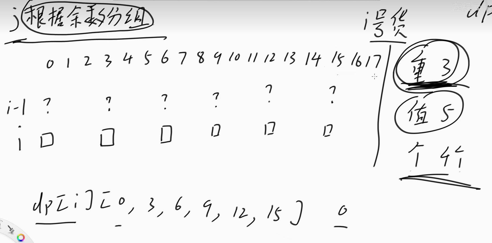
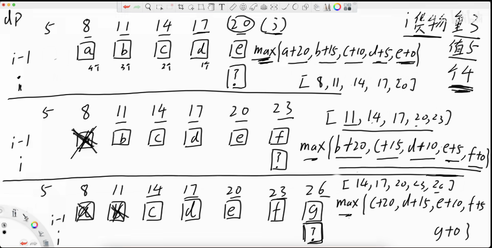
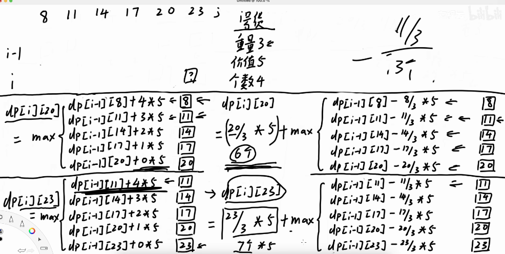

# 动态规划

> 导航：[总笔记](Craving.md) · [图论](图论.md)

> 📋 配套题单：[动态规划 66-88 题单](动态规划66-88题单.md)
> 📝 题解统一放 `study/Problemset/`，命名 `题号. 题目名.md`
> 🗂️ 讲次导航：070、071 的题已全在「子数组最大累加和」小节；066~069、072~088 见本章末尾「讲次题目索引」

### 思想

1. 任何动态规划问题都一定对应着一个有重复调用行为的递归（从递归入手）
2. 最长回文子序列 = 原串与逆序串的最长公共子序列
3. 从递归到递推，三步：
   - 第一步要会**描述局面**（看待问题的方式）
   - 转移方式：递归是自顶向下，递推可以自底向上；递推要看向哪边求值 —— **前面填好了才能填后面**
   - 因此，**递推方向一般与对应递归方向相反**，只保留"归"

### 记录

1. 划分子问题：当前问题依赖前面还是后面，决定是正推还是逆推（编码顺序）
2. 递归加记忆化搜索
3. 求[斐波那契数](https://leetcode.cn/problems/fibonacci-number/)（LC509）：最快是矩阵快速幂 $O(\log n)$
4. 带路径的递归无法改成动态规划 —— [单词搜索](https://leetcode.cn/problems/word-search/)
   - 题意：在字符网格里四方向相邻地走，判断能否拼出目标单词，同一格不能重复走
   - 原因：
     ```text
     防止走重复路径改了原组，状态并非相同
     带路径的递归（可变参数类型复杂）
     ```
5. 记忆化搜索记录的值为负数时，是否可以改成可统计的值
   - ⬜ [盈利计划](https://leetcode.cn/problems/profitable-schemes/)（多维费用背包）

### 子数组最大累加和问题

**[最大子数组和](https://leetcode.cn/problems/maximum-subarray/)（LC53）**

- 要求连续
- 做法一：**前缀和 + 贪心**
  - 维护"前缀和"与"最小前缀和"，答案为 `前缀和 − 最小前缀和` 取 max
  - 最小前缀和怎么维护：沿途比较记录即可
- 做法二：以 `i` 为结尾往左延伸，或以 `i` 为开头往右延伸（逆序遍历）
- 附加问题：返回最大子数组的 `left / right / sum`（不止一个时返回哪一个都可以）
  - dp 时若继承前面的值：`l` 记录上一步，`r` 记为本步
  - 若取自身：`l = r = 自身下标`
  - 只有当 `sum` 比之前大时才更新

- [ ] **[乘积最大子数组](https://leetcode.cn/problems/maximum-product-subarray/)（LC152）** —— [讲解 071 · 题目1](<C:\Users\wait\Desktop\cCourseware\md\算法讲解071【必备】子数组最大累加和问题与扩展-下.md>)
  - 题意：求乘积最大的非空连续子数组（维护“最大 / 最小”两个值，课上讲的是 int、double 都通用的做法）

**[不能连续选数的最大累加和](https://leetcode.cn/problems/house-robber/)（LC198 打家劫舍）**

- 转移需要隔一个阶段转移
- 或者每个点存储"选 / 不选"两种情况

**[环形最大连续子数组](https://leetcode.cn/problems/maximum-sum-circular-subarray/)（LC918）**

- 正难则反
- 分为两种情况：最大连续 / 不连续；不连续就等于总和减去最小连续和
- 特殊处理全部为负数：此时最大为数组最大值；如果"最小连续和等于总和"就返回最大值（保存在最大连续和中）

**[环形不能取相邻](https://leetcode.cn/problems/house-robber-ii/)（LC213）**（环形子序列，不能相邻）

- 对首位特殊处理：如果取了首位，那么末尾不能取，对 `(2, n-2)` 操作；如果不取，对 `(1, n-1)` 操作

**给定数组 nums，从中选择一个长度至少为 k 的子序列 A，要求 A 中没有任何元素在 nums 中是相邻的，最小化 max(A)**（[LC2560 打家劫舍 IV](https://leetcode.cn/problems/house-robber-iv/)）

- 二分 `max`：判定"不取相邻的最长序列"是否满足长度 ≥ k，满足返回 true，不满足返回 false
- 二分后贪心：能偷就偷

**给定数组，从中取长度至少为L，求其最大平均值**（左神课程里没找到；描述与洛谷 P1404 平均数一致，待你确认）

-   二分平均值，(l为min,r为max)

-   构造新数组 $b_i = a_i-mid$

-   要求 $j-i\ge L，即 i\le j-L$​。所以只需要判断：
    $$
    \boxed{s_j-\min_{0\le i\le j-L}s_i\ge 0}
    $$
    

    -   求长度至少为L是否有字段和大于等于0；
    -   维护前缀最小和，i=L开始枚举，这样保证长度大于等于L；

-   对于存在小数处理，浮点二分

-   `while(r-l>1e-(n+2))`保留n位小数

**[最大子矩阵](https://leetcode.cn/problems/max-submatrix-lcci/)（面试题 17.24）**

- 如果只有 0/1 且找全为 1 的子矩阵：用单调栈求最大矩形，枚举以每行为底，中间断开直接为零
- 任意数：注意数据量，方法是 $O(n^3)$
  - 枚举起始行，再枚举末尾行，压缩为一行，求最大子数组和

**选定子序列的和要是 k 的倍数，且最大** —— [讲解 071 · 题目2](<C:\Users\wait\Desktop\cCourseware\md\算法讲解071【必备】子数组最大累加和问题与扩展-下.md>)（原题是“必须被 7 整除”，对数器验证）

- `dp[i][j]`：前 `i` 个里模数为 `j` 的最大值
- 注意初始化；分为第 i 个"选 / 不选"；**有些模数没有就不能选**（别拿 0 当有效值）

**给你两次机会可以让连续一段化为零，求最大数组和（魔法卷轴）** —— [讲解 071 · 题目3](<C:\Users\wait\Desktop\cCourseware\md\算法讲解071【必备】子数组最大累加和问题与扩展-下.md>)（对数器验证）

- 分为：不用 / 用一次 / 用两次
- 用一次：求前后缀最大子数组和
  - 前缀：`dp[i]` 表示"使用一次卷轴"的最大子数组和
  - 转移分为"要 i"与"不要 i"
    - 不要 i：就等于以 `i` 为头向前延伸刷成零 → 转移为前缀最大 `maxpresum`
    - 要 i：`dp[i-1] + nums[i]`
- 用两次卷轴：枚举两次卷轴区间 `(0, i)`、`(i+1, n-1)`

**[三个无重叠子数组（长度为 k）的最大和](https://leetcode.cn/problems/maximum-sum-of-3-non-overlapping-subarrays/)（LC689）**（返回每个开头下标）

- 优先维护每个长度为 k 的区间和，再跑前后缀，找到"以 i 为末尾"的最大值

**[最多删除一次求最大子数组和](https://leetcode.cn/problems/maximum-subarray-sum-with-one-deletion/)（LC1186）**

- 前后缀做法
  - 不删：跑一次最大子数组和
  - 删：枚举删除点，此时需要"以 i 点为结尾的最大前缀" + "以 i+2 为开头的最大后缀"
- dp 维护方式**未理解** → <https://leetcode.cn/problems/maximum-subarray-sum-with-one-deletion/description/>
  - 题意：最多删掉一个元素，求剩余数组的最大子数组和
- 拓展：至多 k 次 / 恰好 k 次 / 至少 k 次
  - 【至少 k 次】其实是脑筋急转弯：转换成"选择数组中至多 n−k 个数字"，排序后从大往小选择即可，选 n−k 个数，或者遇到 ≤ 0 的数为止

**选择一个范围翻转的最大子数组和** —— [讲解 071 · 题目5](<C:\Users\wait\Desktop\cCourseware\md\算法讲解071【必备】子数组最大累加和问题与扩展-下.md>)（对数器验证）

-   必须翻转 / 不翻转 / 翻转 三种情况；注意区间长度为 1 时等价于不翻转

-   左边前缀最大子数组，一定能翻转到与右边后缀子数组最大和相接
-   最后考虑

- [ ] **删掉 1 个数字后长度为 k 的子数组最大累加和** —— [讲解 071 · 题目6](<C:\Users\wait\Desktop\cCourseware\md\算法讲解071【必备】子数组最大累加和问题与扩展-下.md>)（对数器验证）
  - 题意：必须删掉一个数字，求新数组中长度为 k 的子数组最大累加和
  - **前置**：单调队列
  - 考察每一个长度为k+1长度的子数组，减去区间中最小值(单调队列求解（单调递增，队头取得)

**给定一个长度为*n*的非负序列*A*，请你找出一个长度不小于*L*的子段（子段是序列A中一些连续的元素构成的集合），使得子段中数值的平均值最大。最终输出这个最大的平均值。**

```cpp
输入格式:
第一行两个整数n,L(1<=L<=n<=100,000)

以下n行，每行一个非负整数，表示序列A中每个元素的值。

输出格式:
一个整数，欲求的最大平均值乘以1000后的结果（注意不要四舍五入，直接输出）。

输入样例:
10 6
6 
4
2
10
3
8
5
9
4
1
输出样例:
6500
    #include <bits/stdc++.h>
using namespace std;
const int N = 2e5;
int a[N];

int n,m;
bool cheak(int mid)
{
    vector<long long>sum(n+1,0);
    for(int i =1;i<=n;i++)
        {
            sum[i] +=sum[i-1]+a[i]-mid;
        }
    //最大字段和，且长度大于m
    long long minpremsum = 1e9;
    for(int i = m;i<=n;i++)
        {
            minpremsum = min(minpremsum,sum[i-m]);
            if(sum[i]-minpremsum>=0)
            {
                return true;
            }
        }
    return false;
}
int main()
{
    //二分
    cin >> n >> m;
    int l = 1e9 , r = -1e9;
    for(int i = 1; i<= n;i++)
        {
            cin >>a[i];
            a[i]*=1000;
            l = min(l,a[i]);
            r = max(r,a[i]);
        }
    while(l<r)
        {
            int mid = (l+r+1)/2;
            if(cheak(mid))
                l=mid;
            else 
                r =mid-1;
        }
    cout << l;
    
}
```


-   二分平均值
-   处理长度至少为多少
-   每个数减去平均值是否有字段满足大于零

### 最长递增子序列问题

**LIS**

[线性dp](D:\c\code\yy\AcWaitd\DP\linear_dp\Linear_Template.cpp)

-   贪心策略，让每个长度所代表值更小，后面更容易增长

-   非严格改为upper，允许相同出现，找到严格大的位置来替换，严格的话相同也是替换不能增加长度

-   如果要返回具体是哪些数据

    -   因为贪心，后面的点会更改f数组中存储的该长度的最小末尾，但是此时该点在后面无法与之前构成序列形成连接
    
    -   ```cpp
        class Solution {
        public:
            vector<int> getLIS(vector<int>& a) {
                int n = a.size();
                vector<int> f(n + 1);//存储长度为i的最小末尾
                vector<int> pos(n + 1, -1);// pos[k]：长度为 k 的递增子序列中，最小末尾元素的原数组下标
                vector<int> pre(n, -1);//i号节点的前驱
                int len = 0;
        
                for (int i = 0; i < n; i++) {
                    int k = lower_bound(
                        f.begin() + 1, f.begin() + len + 1, a[i]
                    ) - f.begin();
        
                    // 先记录：当前元素接在哪个元素后面
                    if (k > 1) {//k位置时替换点，i的前驱就是k-1长度的位置
                        pre[i] = pos[k - 1];
                    }
        
                    f[k] = a[i];
                    pos[k] = i;//更新长度为k的位置
                    if (k > len) len = k;
                }
        
                vector<int> ans;
                if (len == 0) return ans;
        
                // 从最后一个元素沿前驱倒着找
                for (int i = pos[len]; i != -1; i = pre[i]) {
                    ans.push_back(a[i]);
                }
                reverse(ans.begin(), ans.end());
                return ans;
            }
        };
        // ==============================
        // 6. 最长不下降子序列（非严格上升）
        // ==============================
        int lnds_nlogn(vector<int>& a) {
            vector<int> d;
            for (int x : a) {
                auto it = upper_bound(d.begin(), d.end(), x);  // 用 upper_bound！
                if (it == d.end()) d.push_back(x);
                else *it = x;
            }
            return d.size();
        }
        // r[i]：原数组中以 i 开头、向右的最长不下降子序列长度
        // 从右往左遍历，转化为求以当前元素结尾的最长不上升子序列
            vector<int>f;
            for(int i = n; i>0;i--)
            {
                auto pos = upper_bound(f.begin(),f.end(),a[i],greater<int>());//小于x位置
                if(pos == f.end())
                {
                    f.push_back(a[i]);
                    r[i] = f.size();
                }
                else
                {
                    *pos = a[i];
                    r[i] = pos-f.begin()+1;
                }
        
            }
        ```
    
    [354. 俄罗斯套娃信封问题](https://leetcode.cn/problems/russian-doll-envelopes/)
    
    -   二维嵌套，小装进大
    -   按照高度排序， 同高时宽度降序，高度相同只能选择一个，因此宽度高的在前避免高度相同子序列增加
    
    [2111. 使数组 K 递增的最少操作次数](https://leetcode.cn/problems/minimum-operations-to-make-the-array-k-increasing/)
    
    -   题目要求均为正数，修改后各组分别非严格递增，因此分组求最长非严格递增
    
    -   如果题目改为严格递增，例如2，1，2，3，4，5，不能改成0，1，2，3，4，5；
    
        -   把每个数减去其下标，然后对所有正整数求最长非降子序列。
    
            举个例子，现在每 *k* 个数选一个数，假设选出来的数组是 [3,2,4,5,5,6,6]。
    
            每个数减去其下标后就是 [3,1,2,2,1,1,0]。
    
            对这个数组中的**正整数**(负数表示，减去下标后为负数，还原回去，这个点一定会被改掉，因为最小为1，2，3，4，5，6，减去下标后为1，1，1，1，1，如果为零或者负数说明该点必须被修改）求最长非降子序列，那就是 [1,1,1] 了，对应原始数组的 [∗,2,∗,∗,5,6,∗]，这三个数字保留，其余数字修改完成后就是 [1,2,3,4,5,6,7]，符合严格递增且均为正整数的要求。
    
            注：上述减去下标的技巧，**主要是为了能让保留的数字之间可以容纳严格递增的数字**。否则，若直接按照最长严格递增子序列的求法，会得到例如 [∗,2,4,5,∗,6,∗] 这样的错误结果。
    
    [646. 最长数对链](https://leetcode.cn/problems/maximum-length-of-pair-chain/)
    
    -   以左边界排序，ends中存储长度为len的最小右边结尾，用左边界结尾到ends中查询能否更新右界或者接在后面
    -   以右边界排序，贪心策略能连就连
    
    [可以更改连续k个为相同的最长不下降](https://www.luogu.com.cn/problem/P8776)
    
    -   可以知道在i位置，对前面k个改为相同，再到0~i-k-1中找能连接i位置的最长，加上后面以i开头的最长(逆序预先处理)
    -   对于前面最长在区间k个外才加入ends中
    -   对于最后一种情况，末尾的k个改为相同
    
    #### 记录
    
    -   对于
    
        ```cpp
        // 没找到时
        it == dp.end();
        
        // 对应的下标
        it - dp.begin() == dp.size();即为len，
        ```
    
        -   最长递增子序列的数量问题
        -   给定一个未排序的整数数组nums，返回最长递增子序列的个数
        -   测试链接 :
        -   https://leetcode.cn/problems/number-of-longest-increasing-subsequence/
        -   这个问题的最优解能做到$O(n * logn)$
        -   会放在【扩展】课程阶段，详解树状数组(index tree

### 网格dp

- 如果从 `(0,0)` -> `(n-1, m-1)`，意味着向右走 `m-1` 步、向下走 `n-1` 步，顺序随意
  - 换句话说：在 $(m+n-2)$ 步里选出 $m-1$ 步往右，方案数就是这个组合数

#### 题目

- 从左上往右下，矩阵中走的路径和能被 k 整除的路径数（[LC2435](https://leetcode.cn/problems/paths-in-matrix-whose-sum-is-divisible-by-k/)）
  - k 比较小：可以改成递推（记忆化即递推）
  - k 比较大（开不出大小为 k 的数组）：只能写递归
  - 折半搜索：搜索到对角线上，记录信息，用 `map(key, cnt)`

### 树形dp

- dfn 序：依照递归顺序，给每个节点重新标记
- **两次 `dfs`**：对于某一个点的权值之和，不仅需要孩子的信息，也需要父亲的信息 —— 这种问题常常用两次 `dfs` 来解决
  ```text
  P3047 [USACO12FEB] Nearby Cows G
  1. 第一次 dfs 解决只往下时，权值之和；
  2. 第二次 dfs 解决上下都考虑时，权值之和。
  ```

- 题目：[P3047 Nearby Cows G（USACO12FEB）](https://www.luogu.com.cn/problem/P3047) ｜ 笔记：[P_3047_USACO_12_FEB_Nearby_Cows_G.md](../AcWaitd/DP/tree_dp/P_3047_USACO_12_FEB_Nearby_Cows_G.md)


#### 题目

- [爬楼梯](https://leetcode.cn/problems/climbing-stairs/)（LC70）
- [P1095 守望者的逃离（NOIP 2007 普及组）](https://www.luogu.com.cn/problem/P1095)
  ```text
  一直跑与休息跑比较，最后结合；
  ```
- [力扣 最低票价](https://leetcode.cn/problems/minimum-cost-for-tickets/description/)
  - 题意：给出要出行的日期数组 `days`，以及 1 天 / 7 天 / 30 天三种票的价格，求覆盖全部出行日的最小花费
  - 复盘：
    ```text
    会写递归，但是忘记加记忆化超时
    不会写递推也就是动态规划
    从后往前推，左边依赖右边已经填好
    如果顺推，每个点都有多种转移方式（感觉行）
    ```
  - 写法（按日期顺推，非出行日继承前一天）：
    ```cpp
    class Solution {
    public:
        int mincostTickets(vector<int>& days, vector<int>& costs) {
            int n = days.back();
    
            unordered_set<int> st(days.begin(), days.end());
    
            vector<int> dp(n + 1, 0);
    
            for (int i = 1; i <= n; i++) {
    
                // 今天不旅行
                if (!st.count(i)) {
                    dp[i] = dp[i - 1];
                }
    
                // 今天旅行
                else {
                    dp[i] = min({
                        dp[i - 1] + costs[0],
                        dp[max(0, i - 7)] + costs[1],
                        dp[max(0, i - 30)] + costs[2]
                    });
                }
            }
    
            return dp[n];
        }
    };
    ```
  - 递归 / Lambda 写法备忘：
    ```cpp
    auto dfs = [&](auto&& dfs, int i) -> int
    ```
    - `[&]`：Lambda 可以使用外面的变量，并且按引用捕获
    - `auto&& dfs`：表示可以调用自己
    - `-> int`：这个 Lambda 返回 `int`
- [解码方法](https://leetcode.cn/problems/decode-ways/)（LC91）
  ```cpp
  递归转递推，边界条件处理
  // if(s[i-2]!='0'&&i-1>0)//会报错，非法访问i-2位置。先写边界有效
  if(i>1&&s[i-2]!='0')
  ```
### 背包dp

> 模板：[Knapsack_Template.cpp](../AcWaitd/DP/knapsack_dp/Knapsack_Template.cpp)
>
> 先明确：**每件物品能选几次、容量表示什么、求最值还是方案数。**
> 基础模板为整理时补充，供复习查阅，不代表已经独立掌握。

#### 状态与初始化

容量为 `V`，物品费用为 `w[i]`，价值为 `v[i]`。以下普通背包模板假设 `w[i] > 0`。

| 目标 | `f[j]` 的含义 | 初始化 |
| --- | --- | --- |
| 不超过容量，求最大价值 | 总费用不超过 `j` 的最大价值 | 全部为 `0`，允许不选 |
| 恰好装满，求最大价值 | 总费用恰好为 `j` 的最大价值 | `f[0] = 0`，其余为负无穷 |
| 恰好凑出目标，求最小花费 | 恰好凑出 `j` 的最小花费 | `f[0] = 0`，其余为正无穷 |
| 恰好凑出目标，求方案数 | 恰好凑出 `j` 的方案数 | `f[0] = 1`，其余为 `0` |

- **状态含义决定初始化**，不能所有背包都把数组清零。
- 不可达状态不能直接参与最值转移；注意无穷值相加溢出。
- 求方案数前，明确物品是否可区分、是否区分选择顺序；按题意取模或使用 `long long`。

#### 0/1 背包

每件物品最多选一次，分为“选 / 不选”。

`f[i][j] = max(f[i-1][j], f[i-1][j-w[i]] + v[i])`，第二项仅在 `j >= w[i]` 时可用。

空间压缩后，**容量倒序**，保证使用上一层状态，同一件物品不会重复选。

```cpp
for(int i = 1; i <= n; i++)
{
    for(int j = V; j >= w[i]; j--)
    {
        f[j] = max(f[j], f[j-w[i]] + v[i]);
    }
}
```

以上代码对应“不超过容量，求最大价值”，`f` 全部初始化为 `0`。时间 $O(nV)$，空间 $O(V)$。

##### 目标和

[494. 目标和](https://leetcode.cn/problems/target-sum/)

设取正号的数之和为 $A$，取负号的数之和为 $B$，所有数之和为 $sum$：

$$
A-B=target,\qquad A+B=sum
$$

因此 $A=(sum+target)/2$，转化为：**选出和恰好为 `(sum+target)/2` 的子集，求方案数**。

- 如果 `abs(target) > sum`，或 `sum+target` 为奇数，答案为 `0`。
- 初始化 `f[0] = 1`，其余为 `0`；每个数倒序更新 `f[j] += f[j-nums[i]]`。
- 数值为 `0` 时，正负号是两种方案，更新会使已有方案数翻倍，不能忽略。
- 例：`sum = 11, target = 1`，就是求子集和为 `6` 的方案数，剩下的和为 `5`。
- 原始递归需要记录负数状态，可用哈希表或数组偏移。若推广到含负数的输入，因为每个数前都能选正负号，可以先取绝对值。

##### 最后一块石头的重量 II

[1049. 最后一块石头的重量 II](https://leetcode.cn/problems/last-stone-weight-ii/)

- 转化为分成两组，使两组重量差尽可能小。
- 取容量 `V = sum/2`，每块石头的费用和价值都等于其重量。
- **`f[j]` 表示总重量不超过 `j` 时，能选出的最大重量**，不是“能否恰好凑出 `j`”。
- 倒序更新：`f[j] = max(f[j], f[j-nums[i]] + nums[i])`。
- 答案为 `sum - 2*f[sum/2]`，不需要再从一半往前找可达位置。

#### 完全背包

每种物品可以选无限次。选当前物品后，仍然可以继续选它。

`f[i][j] = max(f[i-1][j], f[i][j-w[i]] + v[i])`，第二项仅在 `j >= w[i]` 时可用。

空间压缩后，**容量正序**，允许使用本层已经更新过的状态。

```cpp
for(int i = 1; i <= n; i++)
{
    for(int j = w[i]; j <= V; j++)
    {
        f[j] = max(f[j], f[j-w[i]] + v[i]);
    }
}
```

以上代码对应“不超过容量，求最大价值”。时间 $O(nV)$，空间 $O(V)$。

**求方案数时，循环顺序也会改变计数对象：**

- 物品在外、容量正序在内：不区分选取顺序，统计组合。
- 容量在外、物品在内：区分选取顺序，统计排列。
- 例：费用为 `1、2`，凑出 `3`。组合有 `1+1+1、1+2`；排列还包括 `2+1`。

#### 分组背包与有依赖的背包

**分组背包：每组最多选一个。** 同一组的候选互斥，不能叠加选取。若题目要求每组恰好选一个，需要另行处理“不选”和不可达状态。

- 二维转移：不选本组，或从上一组的状态转移到本组某一个候选。
- 压缩写法：**组在外、容量倒序、组内物品在最内层**；这里假设物品费用为正。
- 不要把组内物品放到容量循环外面，否则容易变成“同一组可以选多个”。
- 时间复杂度为“所有组的候选物品总数 × 容量”，即 $O(nV)$。

**有依赖的背包：**买某个物品必须先购买它的前置物品。

[金明的预算方案 · 本地代码](../AcWaitd/DP/knapsack_dp/P_1064_NOIP_2006_提高组_金明的预算方案.cpp)

- 对于“主件 + 附件”这类题，枚举每组的合法组合，视为互斥的复合物品。
- 主件有两个附件时，候选是：主件、主件 + 附件 1、主件 + 附件 2、主件 + 两个附件。
- 每组选择“不买”或一种合法组合，转化为分组背包。
- 更一般的树形依赖，不一定适合枚举所有组合，需要另行设计树上背包状态。

#### “至少”背包：把容量理解为剩余需求

`f[j]`：获得**至少 `j` 数量**的物品所需的最小花费。假设数量 `p[i] > 0`，花费 `c[i] >= 0`。

**初始化：**

```cpp
memset(f, 0x3f, sizeof f);
f[0] = 0;
```

选择当前物品后，剩余需求为 `max(0, j-p[i])`：

- `j > p[i]`：还需要 `j-p[i]`。
- `j <= p[i]`：当前物品已足够，剩余需求归零，允许超额满足。

**完全背包模板：**

```cpp
for(int i = 1; i <= n; i++)
{
    for(int j = 1; j <= m; j++)
    {
        f[j] = min(f[j], f[max(0, j-p[i])] + c[i]);
    }
}
cout << f[m];
```

- 无限次选：`j` 正序，枚举 `1…m`。
- 最多选一次：同一转移，`j` 改为从 `m` 到 `1` 倒序枚举。
- 答案直接取 `f[m]`，无需额外枚举所有超出需求的总量。
- 无穷值相加不能溢出；花费较大时用 `long long`。
- **记忆：超额满足时，剩余需求归零。**

#### 多重背包与混合背包

多重背包中，第 `i` 种物品最多选 `cnt[i]` 件。

| 做法 | 思路 | 最大价值问题的时间复杂度 |
| --- | --- | --- |
| 直接枚举 | 从上一层枚举选 `0…cnt[i]` 件 | 容量乘各物品枚举次数之和 |
| 二进制优化 | 拆成数量为 `1、2、4…剩余数量` 的复合物品，转成 0/1 背包 | 容量乘拆分后的物品总数 |
| 单调队列优化 | 按容量模 `w[i]` 的余数分组，维护有件数限制的滑动窗口最值 | $O(nV)$ |

##### 对于单调队列优化



如图对于第i号货物，只依赖0，3，6，9，12，15位置且只要后四个，维护该个区间最值即可

单独对于i号物品，起始位置分别为mod3为0，1，2分为三组，即可更新完i号物品可能放的位置，每个位置放维护区间长度为4+1(不选)的最值





看图可以知道，如果直接计算，区间内的值需要随着向后处理而变动，所以需要将其固定，优化为第二种方法

**单调队列优化模板（容量不超过 `W`，求最大价值）：**

当前物品重量为 `w`、价值为 `v`，最多选 `s` 件。按容量模 `w` 的余数 `r` 分组，当前容量写成 `r+t*w`，来源容量写成 `r+k*w`：

$$
dp[r+tw]=\max_{\max(0,t-s)\le k\le t}\left(old[r+kw]+(t-k)v\right)
=tv+\max_{\max(0,t-s)\le k\le t}\left(old[r+kw]-kv\right)
$$

- `old` 表示处理当前物品前的上一层值。二维版本读取 `dp[i-1]`；一维版本通过倒序更新和及时移除队列中的已更新位置，保证来源仍是上一层值。
- 队列存组内下标 `k`，按 `old[r+k*w]-k*v` 从大到小维护，队首就是最优来源。
- 不能直接比较原来的 `old`：原价值更大，补上当前物品后不一定更大。
- 来源 `k` 对应本次选 `t-k` 件；`k < t-s` 时过期。窗口最多 `s+1` 个位置，包含选 `0` 件。
- 取队首对应的修正值，再加当前统一的 `t*v`，即可直接得到当前状态的最大值，无需遍历窗口。

输入：`n` 种物品，背包容量为 `W`；`v[i]`、`w[i]`、`m[i]` 分别表示价值、重量和最多件数，要求 `w[i] > 0`、`m[i] >= 0`。上面公式中的 `s` 对应当前物品的 `m[i]`，`ll` 表示 `long long`。

**二维版本：**

```cpp
vector<vector<ll>> dp(n+1,vector<ll>(W+1,0));
for(int i = 1;i<=n;i++)
{
    // 按重量的余数分组；w[i]>W 时需包含 mod=W，所以用 W+1。
    for(int mod = 0;mod<min(W+1,w[i]);mod++)
    {
        deque<int>q;
        for(int j = mod;j<=W;j+=w[i])
        {
            // 按修正值递减维护，队首为最优来源。
            while(q.size()&&
                  dp[i-1][q.back()]-1LL*(q.back()/w[i])*v[i]
                  <=dp[i-1][j]-1LL*(j/w[i])*v[i])
            {
                q.pop_back();
            }
            q.push_back(j);//包含当前物品选 0 件的情况。
            if(q.front()==j-1LL*w[i]*(m[i]+1LL))//移除过期来源。
            {
                q.pop_front();
            }

            dp[i][j] = dp[i-1][q.front()]
                       +1LL*((j-q.front())/w[i])*v[i];
        }
    }
}
// 答案为 dp[n][W]。
```

**空间压缩版本（与二维版本二选一）：**

```cpp
vector<ll> dp(W+1,0);
for(int i = 1;i<=n;i++)
{
    for(int mod = 0;mod<min(W+1,w[i]);mod++)
    {
        deque<int>q;//逆序处理，先加入尚未更新的上一层值。
        // 加入 m[i] 个来源，对应选 0…m[i]-1 件，包含起点自身。
        for(int k = W-mod,t = 1;k>=0&&t<=m[i];k-=w[i],t++)
        {
            while(q.size()&&
                  dp[q.back()]-1LL*(q.back()/w[i])*v[i]
                  <dp[k]-1LL*(k/w[i])*v[i])
            {
                q.pop_back();
            }
            q.push_back(k);
        }
        for(int j = W-mod;j>=0;j-=w[i])//依赖上一层，容量逆序。
        {
            ll nw = j-1LL*w[i]*m[i];//补入选 m[i] 件对应的来源。
            if(nw>=0)//容量 0 也是合法来源，负下标不能比较或入队。
            {
                while(q.size()&&
                      dp[q.back()]-1LL*(q.back()/w[i])*v[i]
                      <dp[nw]-1LL*(nw/w[i])*v[i])
                {
                    q.pop_back();
                }
                q.push_back(nw);
            }

            dp[j] = dp[q.front()]+1LL*((j-q.front())/w[i])*v[i];
            // 下标递减，j 若仍在队列中必在队首；更新后移除 j。
            // 保留 j-w[i] 的旧值，供下一轮作为选 0 件的来源。
            while(!q.empty()&&q.front()==j)
            {
                q.pop_front();
            }
        }
    }
}
// 答案为 dp[W]。
```

每个下标最多入队、出队各一次，两种写法的时间复杂度均为 `O(nW)`。二维版本额外空间为 `O(nW)`，空间压缩版本为 `O(W)`。

全 `0` 初始化表示容量**不超过** `W`；若要求恰好装满，需要改用负无穷表示不可达，并跳过不可达来源。

**求方案数时，不要直接套二进制拆分：**

> 同一种物品的每一件不可区分时，拆分可能重复计数。
> 例如数量 `6` 拆成 `1+2+3`，选 `3` 件本来只有一种数量选择，却被算成“选 3”与“选 1+2”两种。

- 恰好凑出容量的计数转移：`new[j] = old[j] + old[j-w] + … + old[j-cnt*w]`，只保留下标非负的项。
- 按容量模 `w` 的余数分组，可用**同余类上的滑动窗口和 / 前缀和**优化。
- 最值问题维护窗口最值；计数问题维护窗口和，不要混淆。

**混合背包：**不同物品的次数限制不同。每处理一种物品，按它属于 0/1、完全或多重背包选择对应转移。

#### 数据量过大：前 k 个最小子序列和

非负数组 `nums`，求所有子序列（含空集）中，最小的前 `k` 个累加和：

- $1\le n,k\le 10^5$，题目给出的元素范围为 $1\le nums[i]\le 10^6$。
- 不能存下全部 $2^n$ 个子集；总和最大可达 $10^{11}$，也不适合按总和开背包数组。
- 改用**排序 + 小根堆**，只生成需要的候选状态。

**状态与扩展：**

1. 数组原地升序排序；空集和 `0` 是第一个答案。
2. 小根堆存 `(sum, i)`：当前子序列的和为 `sum`，最大选中下标为 `i`。
3. 初始将 `(nums[0], 0)` 入堆。
4. 每次弹出一个状态，得到下一个答案；若 `i+1 < n`，生成两个状态：

```text
保留当前所选元素，再选下一位：
(sum + nums[i+1], i+1)

将当前最后一位替换成下一位：
(sum - nums[i] + nums[i+1], i+1)
```

- 数组非负且已排序，所以两个新状态的和都不小于出堆状态。
- **相同的和需要保留**：不同下标子序列即使和相同，也各占一个名次。
- 生成过程不会重复生成同一个下标子集，无需用 `set` 去重。
- 空集已占一个答案，只需再取 `k-1` 个；若堆已空，则不存在更多子序列。
- 时间 $O(n\log n+k\log k)$，堆空间 $O(k)$；累加和使用 `long long`。

#### 记忆化中的负数状态

参数可能为负数时，可以使用数组偏移，或用映射保存状态：

```cpp
unordered_map<int, unordered_map<int, int>> mp;
map<pair<int, int>, int> memo;
```

- 常用 C++17 环境中，`unordered_map<pair<int,int>, int>` 需要自行提供哈希函数，不能直接依赖默认的 `std::hash<pair<int,int>>`。
- “负数下标”与“答案可能为负数”是两件事。答案可能为负数时，记忆化的“未计算”标记不能与合法结果冲突。


### 讲次题目索引（066~088）

> 下面这些是**新补进笔记的题**（原先只挂在题单里），用 `- [ ]` 记录「还能不能闭卷做出来」；🔁 / ✅ / ⭐ 的进度仍然只在 [动态规划66-88题单.md](动态规划66-88题单.md) 维护。
> 070、071 的题已经全部写进上面的「子数组最大累加和」小节，不在这里重复。

**066 一维dp**

- [ ] [斐波那契数](https://leetcode.cn/problems/fibonacci-number/)（LC509）
- [ ] [最低票价](https://leetcode.cn/problems/minimum-cost-for-tickets/)（LC983）
- [ ] [解码方法](https://leetcode.cn/problems/decode-ways/)（LC91）
- [ ] [解码方法 II](https://leetcode.cn/problems/decode-ways-ii/)（LC639）
- [ ] [丑数 II](https://leetcode.cn/problems/ugly-number-ii/)（LC264）
- [ ] [最长有效括号](https://leetcode.cn/problems/longest-valid-parentheses/)（LC32）
- [ ] [环绕字符串中唯一的子字符串](https://leetcode.cn/problems/unique-substrings-in-wraparound-string/)（LC467）
- [ ] [不同的子序列 II](https://leetcode.cn/problems/distinct-subsequences-ii/)（LC940，去重思路已在题单里）

**067 二维dp**

- [ ] [最小路径和](https://leetcode.cn/problems/minimum-path-sum/)（LC64）
- [ ] [单词搜索](https://leetcode.cn/problems/word-search/)（LC79，改不了 dp）
- [ ] [最长公共子序列](https://leetcode.cn/problems/longest-common-subsequence/)（LC1143）
- [ ] [最长回文子序列](https://leetcode.cn/problems/longest-palindromic-subsequence/)（LC516，= 原串与逆串的 LCS）
- [ ] [节点数为 n、高度不大于 m 的二叉树个数](https://www.nowcoder.com/practice/aaefe5896cce4204b276e213e725f3ea)
- [ ] [矩阵中的最长递增路径](https://leetcode.cn/problems/longest-increasing-path-in-a-matrix/)（LC329）

**068 二维dp**

- [ ] [不同的子序列](https://leetcode.cn/problems/distinct-subsequences/)（LC115）
- [ ] [编辑距离](https://leetcode.cn/problems/edit-distance/)（LC72，要会完整版：插入a/删除b/替换c）
- [ ] [交错字符串](https://leetcode.cn/problems/interleaving-string/)（LC97）
- [ ] 有效涂色问题：n 个格子，每个格子从 m 种颜色里选一种涂色，要求涂满后 m 种颜色都用到，求有效方法数；1 ≤ n, m ≤ 5000，答案对 1e9+7 取模。（对数器验证）
- [ ] 删除至少几个字符可以变成另一个字符串的子串：给定 s1、s2，返回 s1 至少删除多少个字符，才能让剩余字符串成为 s2 的子串。（对数器验证）

**069 三维dp**

- [ ] [一和零](https://leetcode.cn/problems/ones-and-zeroes/)（LC474，多维费用背包）
- [ ] [盈利计划](https://leetcode.cn/problems/profitable-schemes/)（LC879，多维费用背包）
- [ ] [骑士在棋盘上的概率](https://leetcode.cn/problems/knight-probability-in-chessboard/)（LC688）
- [ ] [矩阵中和能被 K 整除的路径](https://leetcode.cn/problems/paths-in-matrix-whose-sum-is-divisible-by-k/)（LC2435）
- [ ] [扰乱字符串](https://leetcode.cn/problems/scramble-string/)（LC87）

**072 最长递增子序列**

- [x] [最长递增子序列](https://leetcode.cn/problems/longest-increasing-subsequence/)（LC300，还要会“最长不下降”，只改二分策略）
- [ ] [俄罗斯套娃信封问题](https://leetcode.cn/problems/russian-doll-envelopes/)（LC354）
- [ ] [使数组 K 递增的最少操作次数](https://leetcode.cn/problems/minimum-operations-to-make-the-array-k-increasing/)（LC2111）
- [ ] [最长数对链](https://leetcode.cn/problems/maximum-length-of-pair-chain/)（LC646）
- [ ] [有一次修改机会的最长不下降子序列](https://www.luogu.com.cn/problem/P8776)（洛谷 P8776）
- [ ] 预习：[最长递增子序列的个数](https://leetcode.cn/problems/number-of-longest-increasing-subsequence/)（LC673，会用树状数组做）

> 072 的 LIS 最优解是 $O(n\log n)$ 的「贪心 + 二分」；线段树也能做，复杂度和它一样（见「线段树 / 树状数组」小节）。

**073 背包dp：01背包、有依赖的背包（6 题）**

> 代表作：P1048 采药 · 目标和

- [ ] [01背包（模版）：P1048 采药](https://www.luogu.com.cn/problem/P1048)
- [ ] [夏季特惠](https://leetcode.cn/problems/tJau2o/)
- [ ] [目标和](https://leetcode.cn/problems/target-sum/)
- [ ] [最后一块石头的重量 II](https://leetcode.cn/problems/last-stone-weight-ii/)
- [ ] 有依赖的背包（模版）：[P1064 金明的预算方案](https://www.luogu.com.cn/problem/P1064) ｜ [牛客练习](https://www.nowcoder.com/practice/f9c6f980eeec43ef85be20755ddbeaf4)
- [ ] 非负数组前 k 个最小的子序列累加和：给定非负数组，返回所有子序列（含空集）中累加和最小的前 k 个累加和；1 ≤ n, k ≤ 1e5，1 ≤ nums[i] ≤ 1e6。该数据量下 01 背包不可行；题单给出的做法复杂度为 $O(n\log n)+O(k\log k)$，额外空间 $O(k)$；前置：讲解 025~027 堆。

**074 背包dp：分组背包、完全背包（6 题）**

> 代表作：P1616 疯狂的采药 · 正则表达式匹配

- [ ] [分组背包（模版）：P1757 通天之分组背包](https://www.luogu.com.cn/problem/P1757)
- [ ] [从栈中取出 K 个硬币的最大面值和](https://leetcode.cn/problems/maximum-value-of-k-coins-from-piles/)
- [ ] [完全背包（模版）：P1616 疯狂的采药](https://www.luogu.com.cn/problem/P1616)
- [ ] [正则表达式匹配](https://leetcode.cn/problems/regular-expression-matching/)
- [ ] [通配符匹配](https://leetcode.cn/problems/wildcard-matching/)（与上题相似，边界条件不同且更简单）
- [ ] [购买足量干草的最小花费：P2918](https://www.luogu.com.cn/problem/P2918)

**075 背包dp：多重背包、混合背包（5 题）**

> 代表作：P1776 宝物筛选；同一道题分别练习枚举、二进制分组、单调队列三种写法。

- [ ] [多重背包：不进行枚举优化](https://www.luogu.com.cn/problem/P1776)（P1776 宝物筛选）
- [ ] [多重背包：二进制分组转化成 01 背包（模版）](https://www.luogu.com.cn/problem/P1776)
- [ ] [观赏樱花：P1833 樱花](https://www.luogu.com.cn/problem/P1833)
- [ ] [多重背包：单调队列优化](https://www.luogu.com.cn/problem/P1776)
- [ ] [混合背包 + 多重背包普通窗口优化：POJ 1742 Coins](http://poj.org/problem?id=1742)

**076 区间dp-上（6 题）**

> 代表作：戳气球

- [ ] [让字符串成为回文串的最少插入次数](https://leetcode.cn/problems/minimum-insertion-steps-to-make-a-string-palindrome/)
- [ ] [预测赢家](https://leetcode.cn/problems/predict-the-winner/)
- [ ] [多边形三角剖分的最低得分](https://leetcode.cn/problems/minimum-score-triangulation-of-polygon/)
- [ ] [切棍子的最小成本](https://leetcode.cn/problems/minimum-cost-to-cut-a-stick/)
- [ ] [戳气球](https://leetcode.cn/problems/burst-balloons/)
- [ ] [布尔运算](https://leetcode.cn/problems/boolean-evaluation-lcci/)

**077 区间dp-下（6 题）**

> 代表作：移除盒子

- [ ] [完成配对需要的最少字符数量](https://www.nowcoder.com/practice/e391767d80d942d29e6095a935a5b96b)
- [ ] 涂色 & 奇怪打印机：[P4170 涂色](https://www.luogu.com.cn/problem/P4170) ｜ [奇怪的打印机](https://leetcode.cn/problems/strange-printer/)
- [ ] [合唱队：P3205](https://www.luogu.com.cn/problem/P3205)
- [ ] [移除盒子](https://leetcode.cn/problems/remove-boxes/)
- [ ] [合并石头的最低成本](https://leetcode.cn/problems/minimum-cost-to-merge-stones/)
- [ ] [统计不同回文子序列](https://leetcode.cn/problems/count-different-palindromic-subsequences/)

**078 树型dp-上（7 题）**

> 代表作：没有上司的舞会 · 二叉树的直径

- [ ] [最大 BST 子树](https://leetcode.cn/problems/largest-bst-subtree/)
- [ ] [二叉搜索子树的最大键值和](https://leetcode.cn/problems/maximum-sum-bst-in-binary-tree/)
- [ ] [二叉树的直径](https://leetcode.cn/problems/diameter-of-binary-tree/)
- [ ] [在二叉树中分配硬币](https://leetcode.cn/problems/distribute-coins-in-binary-tree/)
- [ ] [没有上司的舞会：P1352](https://www.luogu.com.cn/problem/P1352)
- [ ] [监控二叉树](https://leetcode.cn/problems/binary-tree-cameras/)
- [ ] [路径总和 III](https://leetcode.cn/problems/path-sum-iii/)

**079 树型dp-下（5 题）**

> 代表作：P2014 选课（树上 01 背包）

- [ ] [到达首都的最少油耗](https://leetcode.cn/problems/minimum-fuel-cost-to-report-to-the-capital/)
- [ ] [相邻字符不同的最长路径](https://leetcode.cn/problems/longest-path-with-different-adjacent-characters/)
- [ ] [移除子树后的二叉树高度](https://leetcode.cn/problems/height-of-binary-tree-after-subtree-removal-queries/)（dfn 序相关）
- [ ] [从树中删除边的最小分数](https://leetcode.cn/problems/minimum-score-after-removals-on-a-tree/)（dfn 序相关；掌握 $O(n^2)$ 即可，更优解涉及启发式合并）
- [ ] [选课（树上 01 背包）：P2014](https://www.luogu.com.cn/problem/P2014)（题单推荐掌握 $O(nm)$：dfn 序 + 状态定义）

**080 状压dp-上（4 题）**

> 代表作：火柴拼正方形

- [ ] [我能赢吗](https://leetcode.cn/problems/can-i-win/)
- [ ] [火柴拼正方形](https://leetcode.cn/problems/matchsticks-to-square/)
- [ ] [划分为 k 个相等的子集](https://leetcode.cn/problems/partition-to-k-equal-sum-subsets/)
- [ ] [售货员的难题（TSP 问题）：P1171](https://www.luogu.com.cn/problem/P1171)

**081 状压dp-下（4 题）**

> 代表作：分配重复整数（枚举子集 $O(n\cdot3^m)$）

- [ ] [每个人戴不同帽子的方案数](https://leetcode.cn/problems/number-of-ways-to-wear-different-hats-to-each-other)
- [ ] [最优账单平衡](https://leetcode.cn/problems/optimal-account-balancing/)
- [ ] [好子集的数目](https://leetcode.cn/problems/the-number-of-good-subsets/)
- [ ] [分配重复整数](https://leetcode.cn/problems/distribute-repeating-integers/)（枚举子集的复杂度为 $O(n\cdot3^m)$，可由二项式定理推出）

**082 用观察优化枚举的技巧-上（7 题）**

> 代表作：买卖股票的最佳时机 IV · DI 序列的有效排列

- [ ] [买卖股票的最佳时机](https://leetcode.cn/problems/best-time-to-buy-and-sell-stock/)
- [ ] [买卖股票的最佳时机 II](https://leetcode.cn/problems/best-time-to-buy-and-sell-stock-ii/)
- [ ] [买卖股票的最佳时机 III](https://leetcode.cn/problems/best-time-to-buy-and-sell-stock-iii)（最多两笔交易）
- [ ] [买卖股票的最佳时机 IV](https://leetcode.cn/problems/best-time-to-buy-and-sell-stock-iv/)（最多 k 笔交易，重点题）
- [ ] [买卖股票的最佳时机含手续费](https://leetcode.cn/problems/best-time-to-buy-and-sell-stock-with-transaction-fee/)
- [ ] [买卖股票的最佳时机含冷冻期](https://leetcode.cn/problems/best-time-to-buy-and-sell-stock-with-cooldown/)
- [ ] [DI 序列的有效排列](https://leetcode.cn/problems/valid-permutations-for-di-sequence/)（状态设计优化 + 观察优化转移方程，重点题）

**083 用观察优化枚举的技巧-下（4 题）**

> 代表作：规划兼职工作 · K 个逆序对数组

- [ ] [规划兼职工作](https://leetcode.cn/problems/maximum-profit-in-job-scheduling/)（观察单调性 + 二分优化枚举，$O(n\log n)$）
- [ ] [K 个逆序对数组](https://leetcode.cn/problems/k-inverse-pairs-array/)（观察 + 窗口累加和，$O(1)$ 维护窗口）
- [ ] [自由之路](https://leetcode.cn/problems/freedom-trail/)（只枚举顺时针最近、逆时针最近两种可能）
- [ ] [累加和不大于 k 的最长子数组](https://www.nowcoder.com/practice/3473e545d6924077a4f7cbc850408ade)（题单指出 $O(n\log n)$ 单调数组 + 二分不是最优，最优 $O(n)$ 含贪心思想；前置：讲解 046）

**084 数位dp-上（4 题）**

> 代表作：统计整数数目

- [ ] [统计各位数字都不同的数字个数](https://leetcode.cn/problems/count-numbers-with-unique-digits/)
- [ ] [最大为 N 的数字组合](https://leetcode.cn/problems/numbers-at-most-n-given-digit-set/)
- [ ] [统计整数数目](https://leetcode.cn/problems/count-of-integers/)
- [ ] [完全没有重复的数字个数](https://leetcode.cn/problems/count-special-integers/)

**085 数位dp-下（4 题）**

> 代表作：windy 数 P2657

- [ ] [windy 数：P2657](https://www.luogu.com.cn/problem/P2657)（相邻两数字之差至少为 2，且无前导零）
- [ ] [萌数：P3413](https://www.luogu.com.cn/problem/P3413)（存在长度至少为 2 的回文子串，答案对 1e9+7 取模）
- [ ] [不含连续 1 的非负整数](https://leetcode.cn/problems/non-negative-integers-without-consecutive-ones/)（统计二进制表示中没有连续 1 的数）
- [ ] 范围内的数字计数：[LeetCode 版本](https://leetcode.cn/problems/digit-count-in-range/) ｜ [P2602 数字计数](https://www.luogu.com.cn/problem/P2602) ｜ [数字 1 的个数](https://leetcode.cn/problems/number-of-digit-one/)

**086 动态规划中得到具体决策方案的技巧（4 题）**

> 代表作：最长递增子序列字典序最小的结果

- [ ] [最长公共子序列其中一个结果](https://www.nowcoder.com/practice/4727c06b9ee9446cab2e859b4bb86bb8)
- [ ] [最小的必要团队](https://leetcode.cn/problems/smallest-sufficient-team/)
- [ ] [最长递增子序列字典序最小的结果](https://www.nowcoder.com/practice/30fb9b3cab9742ecae9acda1c75bf927)
- [ ] [潜水的最大时间与方案：P1759](https://www.luogu.com.cn/problem/P1759)

**087 动态规划中根据数据量猜解法的技巧（4 题）**

> 代表作：贿赂怪兽 · P1439 两个排列的最长公共子序列

- [ ] [贿赂怪兽](https://www.nowcoder.com/practice/736e12861f9746ab8ae064d4aae2d5a9)
- [ ] 选择 k 个数字使得两集合累加和相差不超过 1：从 1~n 中选 k 个数组成集合 A，其余组成集合 B，要求两集合累加和相差不超过 1；能做到就返回任意一种 A 的方案，否则返回长度为 0 的数组；2 ≤ n ≤ 1e6，1 ≤ k ≤ n。来自真实大厂笔试，没有测试链接，对数器验证；重点评估该数据量下 01 背包是否可行。
- [ ] [两个排列的最长公共子序列长度：P1439](https://www.luogu.com.cn/problem/P1439)
- [ ] [使数组严格递增的最小操作数](https://leetcode.cn/problems/make-array-strictly-increasing/)

**088 动态规划专题总结与预告（0 题）**

本讲没有新题，回顾 066~087 的基础状态、子数组和、最长递增子序列、背包、区间 dp、树型 dp、状压 dp、数位 dp，以及优化枚举和恢复方案的技巧。
