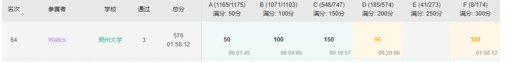
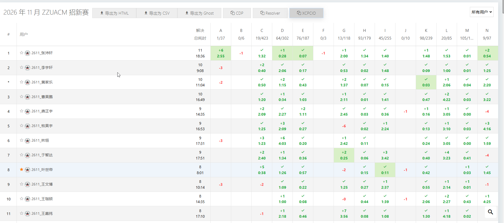

# 日记

[学习资料导航](README.md)

## 按月跳转

先选月份，或直接点击日期。空白日期也保留，方便补记。

[2026-10](#2026-10) · [2026-11](#2026-11) · [2026-12](#2026-12)

- 2026-10：[25](#2026-10-25) · [26](#2026-10-26) · [27](#2026-10-27) · [28](#2026-10-28) · [29](#2026-10-29) · [30](#2026-10-30) · [31](#2026-10-31)
- 2026-11：[1](#2026-11-01) · [2](#2026-11-02) · [3](#2026-11-03) · [4](#2026-11-04) · [5](#2026-11-05) · [6](#2026-11-06) · [7](#2026-11-07) · [8](#2026-11-08) · [9](#2026-11-09) · [10](#2026-11-10) · [11](#2026-11-11) · [12](#2026-11-12) · [13](#2026-11-13) · [14](#2026-11-14) · [15](#2026-11-15) · [16](#2026-11-16) · [17](#2026-11-17) · [18](#2026-11-18) · [19](#2026-11-19) · [20](#2026-11-20) · [21](#2026-11-21) · [22](#2026-11-22) · [23](#2026-11-23) · [24](#2026-11-24) · [25](#2026-11-25) · [26](#2026-11-26) · [27](#2026-11-27) · [28](#2026-11-28) · [29](#2026-11-29) · [30](#2026-11-30)
- 2026-12：[1](#2026-12-01) · [2](#2026-12-02) · [3](#2026-12-03) · [4](#2026-12-04) · [5](#2026-12-05) · [6](#2026-12-06) · [7](#2026-12-07) · [8](#2026-12-08) · [9](#2026-12-09) · [10](#2026-12-10) · [11](#2026-12-11) · [12](#2026-12-12) · [13](#2026-12-13) · [14](#2026-12-14) · [15](#2026-12-15) · [16](#2026-12-16) · [17](#2026-12-17) · [18](#2026-12-18) · [19](#2026-12-19) · [20](#2026-12-20) · [21](#2026-12-21) · [22](#2026-12-22) · [23](#2026-12-23) · [24](#2026-12-24) · [25](#2026-12-25) · [26](#2026-12-26) · [27](#2026-12-27) · [28](#2026-12-28) · [29](#2026-12-29) · [30](#2026-12-30) · [31](#2026-12-31)

## 2026-10

[回到月份索引](#按月跳转)

### 2026-10-25

> [!note] 2026-10-25（周日）

这周连着几天上下课都在看牧神记，完结了。开了《基督山伯爵》有点兴致，但碍于故事背景（法国大革命）有点出戏

昨晚打了cf，3题1900名左右，上分了，成功度过newbie升阶为pupil

做了作业，自己剪辑完成了毛概视频。

放暑假以来，第二次跑步，坚持了30分钟，不停歇，第一次跑20分钟停了好几次。变强了，耶耶。

### 2026-10-26

> [!note] 2026-10-26（周一）

虽然到了小时候最羡慕的年纪，但没能成为小时候想成为的人。

地上布满了五便士，我必须俯身拾起，心中压制的抬起头看月亮的冲动

部署了deepseek在qq端，本地部署语音功能貌似有点波折，生成出来跟原先项目不一样

### 2026-10-27

> [!note] 2026-10-27（周二）

今天没怎么学算法

将qqbot语音功能做出来了，感觉还行，但细节处不如人意。不打算继续完善了，始终是个玩具，还容易分心。

### 2026-10-28

> [!note] 2026-10-28（周三）

今天看了一天的《基督山的伯爵》，看完有些激励，又有些惆怅，算机缘吧，算社会局限吧。说学到了什么也谈不上，看完了报答玩船主突然没看的性质了，前面越狱和推断事件发展很精彩，这是因为智者的光辉吗？

不想写题，看了1130d2的ABC三道题会做，没coding，不想做题。

### 2026-10-29

> [!note] 2026-10-29（周四）

看了会轮廓线dp，看了会小说，做了移到cf A题，很基础的一个题，mex还是不太熟悉。

还是没充分利用时间，没干啥事。

### 2026-10-30

> [!note] 2026-10-30（周五）

### 2026-10-31

> [!note] 2026-10-31（周六）

## 2026-11

[回到月份索引](#按月跳转)

### 2026-11-01

> [!note] 2026-11-01（周日）

昨天cf，今天做线代作业，物理实验。

区间dp，24小时太短；

### 2026-11-02

> [!note] 2026-11-02（周一）

今天下午翘了课，去跟同学黄河游，骑了47公里，我是菜腿，一会就软了

### 2026-11-03

> [!note] 2026-11-03（周二）

今天感觉良好，昨天骑了长距离，早上实在起不来，6：30闹钟，7点起，看了会小说去上物理课，上课睡着了，下一节课逃了，回寝室依旧无所事事，还起飞了一次。之后贤者状态，想去跑步，但是一看时间到饭点了，事已至此，先吃饭吧。

下午午睡20分钟，1：30起床准备跑步计划完成校园跑3公里以上，很累啊，有死规矩，2点还有体育课，慢了也不行，20分钟跑完了，配速6分跑跑走走。下午上体育课老师给我门免了校园跑，PS：老师曾说过1000少跑一个弯道。

之后离散数学，不知道怎么刷到跑步视频（真被监控了，我看片会被发现tag吗，悲），刷到补剂，买了300左右，还有个骑行杯夹。想着复健跑步，1.21参加1500米院运会。晚上跑了5.22，30分钟，还蛮轻松，最后冲了1公里，难受痛苦，但是跟在一个跑的比较块的后面，不甘心掉队。蛮不错。

一道区间dp，开始线段树专题，之后贪心，构造(每天做一道？给GPT吧，这周第一次把额度用完)

### 2026-11-04

> [!note] 2026-11-04（周三）

开始日常思维贪心锻炼，一个晚自习思考了5道题，第一道就吃瘪，不验证很难知道思路是否完备；

坐天跑完右腿膝盖痛，用了尹兄的云南白药好多了

### 2026-11-05

> [!note] 2026-11-05（周四）

做了6道贪心，星期三晚自习推的实践了，思维难度不高，感觉有惰性，是正解，但是有瑕疵，太依赖aidebug了

慢跑30分钟， 明早起床慢跑堆有氧

### 2026-11-06

> [!note] 2026-11-06（周五）

牛客练习赛159，很菜啊，补题，只单独做出来一道

cf只会1道，这可能时我仅有的机会

### 2026-11-07

> [!note] 2026-11-07（周六）

vp一场1032div3，独立4题

补了昨天牛客练习赛BC，写了md，cdp简单，但是优化不好想

cf好难，只会A，BC不会，D有思路是状压DP，ai写了理解了，递归好理解

### 2026-11-08

> [!note] 2026-11-08（周日）

今天打了线上赛，思路有了，细节处理不到位

补了一道线段树

### 2026-11-09

> [!note] 2026-11-09（周一）

vpcf1005di2，赛时两题，补了cd题，

c题dp做出来了，不满足要求，实际是贪心；d题二进制关系进而简化

未写D

对于E能理解，但是实现貌似有点难，有时间研究一下

dp状态设计

### 2026-11-10

> [!note] 2026-11-10（周二）

今天上午跑了强度课，T跑5*4分钟，间歇2分钟，3组4：20，3，4组5：00左右，坚持不下来。

补题cf1133 C题，看了两个hint，有思路也实现到差不差，最后还是有错。

昨天买了6E今天一看快递到没到，发现下面一模一样还都是正品，便宜了20，看一眼亏20，但是我想明天还是后天恢复好了跑I跑。

跑瘾上了，晚上又想去跑步了

跑完回来把cf1555code一下，上最后一节离散数学，想了ABCD，感觉可行

### 2026-11-11

> [!note] 2026-11-11（周三）

人生如果不能做自己喜欢的事情，那还有什么意义

生存与死亡人生的终极命题，我们已经确定的始终，是悲哀的。正是有限，让人寻找生存的意义。

与买桂花同载酒，终不似，少年游。

昨燕已去今忽见，恰逢时，泪满面。、

补昨天codecf1555，今天课上思考了cf2107div2，ABCD，D是数的直径，复习了一下。

先做了cf2107，c题思路全对，但是有个边界条件问题，有错考虑所以分支和边界，ai大人一眼指出，悲啊。

cf2107 即1023，D题复习了一下树的直径，成功做出来，虽然依旧有瑕疵但是很满足

### 2026-11-12

> [!note] 2026-11-12（周四）

vp[Educational Codeforces Round 196 (Rated for Div. 2)](https://codeforces.com/contest/2283)赛时ABC，后续做了D类似tarjan思想，很爽，融会贯通的感觉

人乐在将至而未已至

我们总想回到过去，我们总在精彩的时候抱怨当下的不如意。

### 2026-11-13

> [!note] 2026-11-13（周五）

参加牛客小白月赛140，ACD三道，D题辅助debug。

### 2026-11-14

> [!note] 2026-11-14（周六）

看了昨天比赛B题，十分简单的一道题，被唬住了，需要证明理解。

今天啥也没干，写了几道cp31，出去吃了顿牛肉火锅。

顺便去修了修车，后轮刹车片有点歪，老板说20 前后轮一起修了，前轮有点偏但是每异响。修完确实没了，回去路上可能比较颠簸，快到学校结果发现前轮又异响。感情给我前轮修坏了，悲~~。

### 2026-11-15

> [!note] 2026-11-15（周日）

白天无所事事，不想写题。

晚上做了牛客周赛 Round 170，

还行，但是D貌似只是乱写，F写了很久，没调出来。

晚上CF写写。

CF[Codeforces Round 1135 (Div. 2)](https://codeforces.com/contest/2285)

只会A，B完全靠ai不会推，C自己有想法，但是没理清	

补充提交记录：A/B/C 均已 AC（截图确认）；A 独立完成，B/C 有 AI 辅助推理，C 是自己已有想法后借助 AI 理清。截图为 Practice 页面，不记作独立三题 VP。提交时间分别为 22:40、23:15、23:32。

[本场复盘与 B/C 推导](./Problemset/Codeforces%20Round%201135%20(Div.%202).md)：B 用实际变化的首尾位置去重计数，C 按降序数组中真正修改的前缀长度分类计数。

### 2026-11-16

> [!note] 2026-11-16（周一）

整理 Round 1135 的复盘。后续闭卷重做 B/C，分别检查是否能独立说明计数不重复以及操作可达性。

补昨天牛客DEF，DFcode了，E 理解了，后续补做。

VP Educational Codeforces Round 112（1555），已结束。截图确认 A/B AC，提交绝对时间为 18:41、19:03；无开始时间，暂不统计解题用时。C 考虑两人位置状态，存储过大；D 考虑区间 DP，状态与复杂度过高。赛后 AI 辅助分析：C 用下移列描述路径，D 排除长度 2/3 的回文后枚举六种三周期模式；C/D 待补题，尚未记录 AC。

[本场复盘](./Problemset/Educational%20Codeforces%20Round%20112%20(Rated%20for%20Div.%202).md)

### 2026-11-17

> [!note] 2026-11-17（周二）

VP Codeforces Round 966（Div. 3，2000），已结束。[本场记录](./Problemset/Codeforces%20Round%20966%20(Div.%203).md)：最终截图确认 A/C/D 三题通过。A 于比赛内 00:05:38 AC；B 两次 WA test 11；C 于 00:35:48 AC；D 两次 RE test 2 后，于北京时间 11:11 AC。赛中 AI 仅整理记录；赛后辅助定位 B 的 vis[n+1] 越界，本地将容量改为 n+2，46233 个小规模排列核对通过，尚未重交。E 赛时想到大数放中心，赛后补充每格覆盖次数与排序配对，尚未记录 AC。

### 2026-11-18

> [!note] 2026-11-18（周三）

思维训练，CP-31，AGC-018AB。

“每天少打点游戏”，我已经戒了开学后几周就没打过游戏。我很生气，“你晓得啥子，你并不知道我每天干啥，凭什么对我评价”

“我关心你”，这似乎成了任何说法的原因与源头，是将自己的说辞增添正义性。”你口口声声说的是关心，实则是将莫须有的罪名加在我身上，是斥责“。

妈妈说过年不回去了，我又有点不想去杭州，感觉很冷。想自己回四川，跟暑假一样。自己过，有了前车之鉴。

但是杭州更发达，路刚好，可以骑行，跑步，真正游西湖。

学会让步。

萨特与加缪

### 2026-11-19

> [!note] 2026-11-19（周四）

很忙，但是感觉不知道忙啥。思维训练吧，今天早上AGC-19B，貌似要计算回文子串，了解要用Manacher。

重学了一遍KMP，Manacher，扩展KMP(Z函数，E函数)。没学AC自动机。

今晚依旧赶作业，汇编语言实验。

放松放松肌肉早点上床。

### 2026-11-20

> [!note] 2026-11-20（周五）

今天依旧满课，坐了一天教室；

看了AGC- 020，ABC，会A，B有点思路倒推没想明白，C不会，问了AI，集合对称性。

补题

牛客挑战赛94，一题不会，悲伤…..,ai了AB，C感觉KMP但是复杂度过高。

明天院运会，1500米，今天晚上小跑了10分钟，很爽。加油。

### 2026-11-21

> [!note] 2026-11-21（周六）

今天上午参加了院运会1500米，跑了5：28，小组第5，第一4：49；

下午去体验了按摩，很爽。

晚上很迷茫，做了两道dp发现都不会。

明天招新赛，我大学转折点。我该何去何从。

好累，感觉自己什么都不会了，dp还有点卡壳，连背包都不会了。

### 2026-11-22

> [!note] 2026-11-22（周日）

今天，是招新赛

怎么说前面3个25级，一个 24级其余全是26级，我这一年努力是否白费，我是否有天赋，我是否热爱。

我该怎么办

现在确实轻松了，星期六的1500，不赖，今天也还行，但是脑子确实转不过来，有两题很简单没转过来。

技不如人啊。

大家很强，说明我可以躺！！

### 2026-11-23

> [!note] 2026-11-23（周一）
> 

### 2026-11-24

> [!note] 2026-11-24（周二）
> 

### 2026-11-25

> [!note] 2026-11-25（周三）
> 

### 2026-11-26

> [!note] 2026-11-26（周四）
> 

### 2026-11-27

> [!note] 2026-11-27（周五）
> 

### 2026-11-28

> [!note] 2026-11-28（周六）
> 

### 2026-11-29

> [!note] 2026-11-29（周日）
> 

### 2026-11-30

> [!note] 2026-11-30（周一）
> 

## 2026-12

[回到月份索引](#按月跳转)

### 2026-12-01

> [!note] 2026-12-01（周二）
> 

### 2026-12-02

> [!note] 2026-12-02（周三）
> 

### 2026-12-03

> [!note] 2026-12-03（周四）
> 

### 2026-12-04

> [!note] 2026-12-04（周五）
> 

### 2026-12-05

> [!note] 2026-12-05（周六）
> 

### 2026-12-06

> [!note] 2026-12-06（周日）
> 

### 2026-12-07

> [!note] 2026-12-07（周一）
> 

### 2026-12-08

> [!note] 2026-12-08（周二）
> 

### 2026-12-09

> [!note] 2026-12-09（周三）
> 

### 2026-12-10

> [!note] 2026-12-10（周四）
> 

### 2026-12-11

> [!note] 2026-12-11（周五）
> 

### 2026-12-12

> [!note] 2026-12-12（周六）
> 

### 2026-12-13

> [!note] 2026-12-13（周日）
> 

### 2026-12-14

> [!note] 2026-12-14（周一）
> 

### 2026-12-15

> [!note] 2026-12-15（周二）
> 

### 2026-12-16

> [!note] 2026-12-16（周三）
> 

### 2026-12-17

> [!note] 2026-12-17（周四）
> 

### 2026-12-18

> [!note] 2026-12-18（周五）
> 

### 2026-12-19

> [!note] 2026-12-19（周六）
> 

### 2026-12-20

> [!note] 2026-12-20（周日）
> 

### 2026-12-21

> [!note] 2026-12-21（周一）
> 

### 2026-12-22

> [!note] 2026-12-22（周二）
> 

### 2026-12-23

> [!note] 2026-12-23（周三）
> 

### 2026-12-24

> [!note] 2026-12-24（周四）
> 

### 2026-12-25

> [!note] 2026-12-25（周五）
> 

### 2026-12-26

> [!note] 2026-12-26（周六）
> 

### 2026-12-27

> [!note] 2026-12-27（周日）
> 

### 2026-12-28

> [!note] 2026-12-28（周一）
> 

### 2026-12-29

> [!note] 2026-12-29（周二）
> 

### 2026-12-30

> [!note] 2026-12-30（周三）
> 

### 2026-12-31

> [!note] 2026-12-31（周四）
